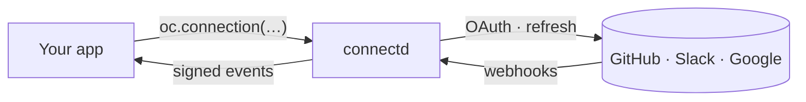

# connectd

**OAuth connections, handled.** Let your users connect GitHub, Slack, Google or any API. connectd holds the tokens, refreshes them, receives the webhooks and tells your app what happened. Your app keeps a user id.

[](https://www.npmjs.com/package/@kavishkagaya/connectd)
[](LICENSE)

[Docs](https://kavishkagaya.github.io/connectd/) · [Quickstart](https://kavishkagaya.github.io/connectd/start/quickstart/) · [Example app](examples/nextjs)

> **Status:** early (v0.2). It works end to end and is tested, but the API can still change between minor versions.



You write one small file per provider. connectd runs each connection as its own small server, holding its token, timers and event queue. Your app names a connection and asks it to do things.

## What you get

- **Tokens never touch your app.** Credentials are encrypted inside connectd. Your app calls the provider through a proxy that adds the token, or runs an action next to it.
- **Refresh and re-auth, handled.** Tokens refresh before they expire, concurrent refreshes share one call, failures retry with backoff, and a connection that needs a new login tells your app with an event.
- **Webhooks in, events out.** Provider webhooks are verified and routed to the right connection, and registered and renewed for you. Your app gets signed, ordered, retried events in the Standard Webhooks format.
- **Rate limits** per connection and per app.
- **One file per provider.** A typed builder, copied from the catalog with `connectd add` or written from a template. Provider code is yours to read and change.
- **Typed actions.** Functions that run next to the token, called from your app, on a schedule, or when a connection changes state.
- **Runs where you run.** `connectd dev` runs everything in memory on your laptop, with a dashboard. `connectd deploy` puts it on your own Cloudflare account, one Durable Object per connection.

## Quickstart

```sh
npm i @kavishkagaya/connectd
npx connectd init          # keys, config, client and one API route
npx connectd add github    # copies the GitHub provider into src/oc/github/
npx connectd dev           # the runtime on :8787, dashboard at /dashboard
```

A connection is a folder. The provider is one file:

```ts
// src/oc/github/connection.ts
import { connection } from "@kavishkagaya/connectd/connections";

export default connection()
  .auth((f) => f.oauth2(endpoints).scopes("repo"))
  .api({ baseUrl: "https://api.github.com" })
  .identity(({ api }) => api.get("/user"));
```

Your app uses it by user id, never by token:

```ts
import { oc } from "@/lib/oc";

const gh = oc.connection("github", user.id);
const { state } = await gh.status();                    // "active", "reauth_required", …
const repos = await (await gh.fetch("/user/repos")).json(); // token added by the proxy
```

Actions run next to the token and are typed end to end:

```ts
// src/oc/github/actions.ts: one object, keyed by the action's name
import { action, actions } from "@kavishkagaya/connectd/connections";
import { z } from "zod";

export default actions({
  starRepo: action({
    input: z.object({ repo: z.string() }),
    run: async ({ api }, { repo }) => {
      const res = await api.fetch(`/user/starred/${repo}`, { method: "PUT" });
      return { starred: res.status === 204 };
    },
  }),
});

// your app
await oc.connection("github", user.id).actions.starRepo({ repo: "octocat/hello-world" });
```

And events arrive in your app, signed and verified:

```ts
// src/oc/github/events.ts
import { listen } from "@kavishkagaya/connectd/sdk";

export default listen("github")
  .on("connection.active", (e) => console.log(`connected: ${e.connection.id}`))
  .on("connection.reauth_required", (e) => console.log(`needs a new login: ${e.connection.id}`));
```

The [quickstart](https://kavishkagaya.github.io/connectd/start/quickstart/) walks through a complete Next.js app in about ten minutes.

## Providers

| Provider | What's included |
| --- | --- |
| `github` | GitHub OAuth app: user tokens, the REST API, repo webhook subscriptions |
| `github-app` | GitHub App: one installation per connection, installation tokens, app webhooks |
| `google` | Google OAuth (OIDC): Calendar and the Google APIs, calendar watch channels |
| `slack` | Slack OAuth v2: bot and user tokens, Events API webhooks |

Anything else starts from a template:

```sh
npx connectd add --custom notion --template oauth2
```

Templates: `oauth2`, `oidc`, `api-key`, `client-credentials`, `jwt-bearer`, `device`. Providers are copied, never installed, so an upgrade never changes your auth code under you. `connectd diff github` shows what changed upstream since you copied it.

## Deploy

```sh
npx connectd deploy                  # production
npx connectd deploy --env staging    # its own Worker, database and keys
```

Each environment is a separate deployment on your Cloudflare account, with its own keys, so staging never reads production's connections. See [deploying](https://kavishkagaya.github.io/connectd/guides/deploying/).

## How it's built

Five layers, and a layer only uses the one below it:

```
L4  DevX         SDK · CLI (init / add / dev / deploy) · dashboard · hosted connect page
L3  Runtime      proxy · webhook ingress · signed event delivery · connection index
L2  Connections  connection() builder · lifecycle · OAuth and other auth flows · actions
L1  Kernel       cell · flight · mutex · timer · queue · ticket · limiter · seal
L0  Platform     Atom (one connection's state) + Platform (env, fetch, logs, calls, db)
```

Each connection runs in its own instance (an Atom). Durable Objects run it in production and memory runs it in dev and tests, and two shared test suites prove both behave the same. The kernel knows how to do things safely (compare-and-swap updates, single-flight, durable timers, exactly-once relay, rate limits, encryption with key rotation) and nothing about tokens or providers. More in [architecture](https://kavishkagaya.github.io/connectd/concepts/architecture/); every design decision is recorded in [DECISIONS.md](DECISIONS.md).

## Contributing

The repo is a Bun workspace.

```sh
bun install
bun run test        # unit tests, plus the Durable Object tests in workerd
bun run typecheck
```

Work is planned as GitHub issues, and every change goes through a pull request. To add a provider, see [contributing a provider](https://kavishkagaya.github.io/connectd/contributing/providers/).

## License

[Apache 2.0](LICENSE)
