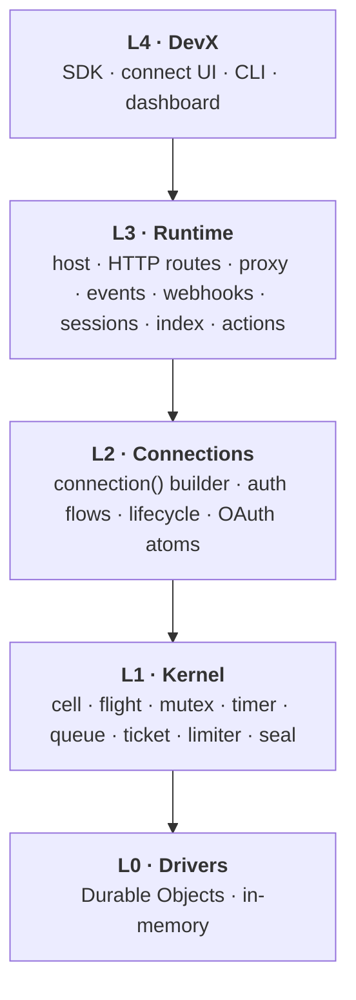
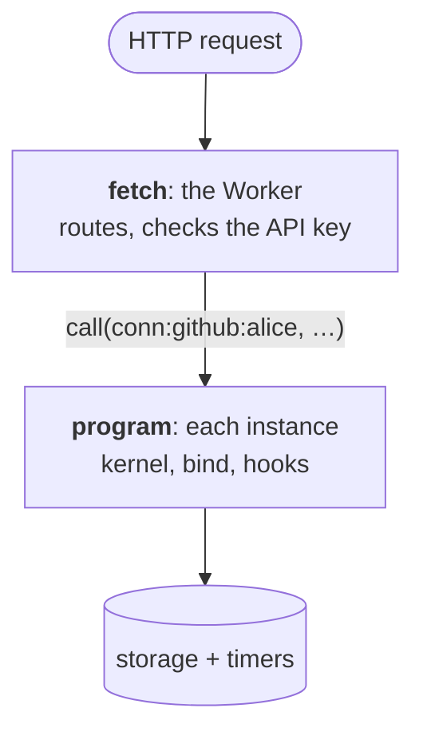
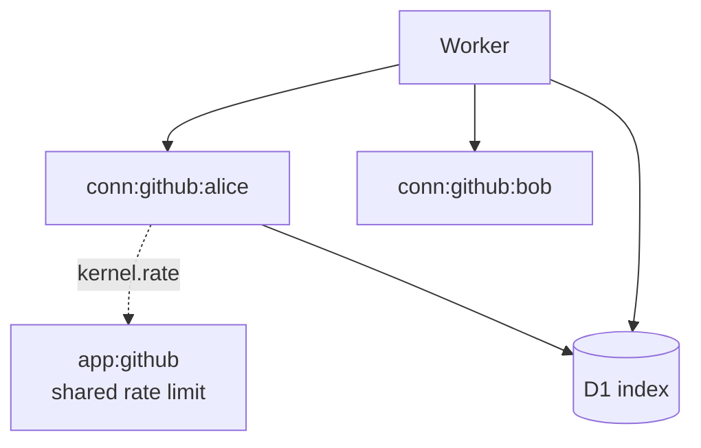

connectd is built in five layers. Each layer uses only the one directly below it, which is how the same code runs in memory, on Cloudflare, and in tests.



| Layer | Package | Knows about |
| --- | --- | --- |
| L4 DevX | `@kavishkagaya/connectd-sdk`, `@kavishkagaya/connectd-connect`, `@kavishkagaya/connectd`, `@kavishkagaya/connectd-dashboard`, `@kavishkagaya/connectd-cloudflare` | Your app, your project, your deploy |
| L3 Runtime | `@kavishkagaya/connectd-runtime` | HTTP, extensions, events, webhooks |
| L2 Connections | `@kavishkagaya/connectd-connections` | OAuth, credentials, states, providers |
| L1 Kernel | `@kavishkagaya/connectd-kernel` | Safe storage, timers and delivery. Nothing about connections. |
| L0 Drivers | `@kavishkagaya/connectd-kernel/memory`, `/do` | Where bytes and alarms live |

## L0 · Drivers: infrastructure only

A driver gives one **instance** four things, and nothing else:

```ts
interface Driver {
  now(): number;
  store: { get; put; cas; take; delete };      // versioned key-value, atomic per op, optional TTL
  timer: { set(name, at, payload?); cancel(name) };  // durable named alarms
  call(instance, method, args): Promise<Json>; // reach another instance
}
```

- `cas` writes only if the version still matches. It's how every race is resolved.
- `take` reads and deletes in one step, so at most one caller gets the value. It's what single-use tickets are built on.
- There are two drivers: **Durable Objects** (production: one DO per instance, its storage, its alarm) and **in-memory** (dev and tests, with a fake or real clock, and a snapshot/restore).

Both pass the same **parity suite**, a shared set of tests run against the memory driver under Bun and against the DO driver inside workerd. New driver behaviour goes into parity, so the two can't drift apart.

## L1 · Kernel: mechanism, never policy

The kernel turns a raw driver into safe tools. Its rule: **a tool that mentions a connection, a token or a provider doesn't belong in the kernel.**

```ts
const k = kernel(driver, { instance, keys, stateKey });
const record = k.cell<Record, Msg>("record");   // declared once…
const refresh = k.flight<Credential>();
return k.serve({ token: async () => … });        // …used through handles
```

| Tool | What it guarantees |
| --- | --- |
| `cell(name)` | Read-decide-compare-and-swap updates. `update(f)` re-runs `f` until its write lands. Plus a **transactional outbox**: messages emitted in an update commit in the same write. |
| `flight()` | Single-flight: concurrent callers share one run and its result. |
| `mutex()` | One at a time, FIFO. |
| `timer(name, { handle, retry, giveUp })` | A durable alarm with a handler. A throw means retry with backoff, and `giveUp` runs after the last attempt. |
| `queue(name, { deliver })` | Ordered, at-least-once delivery with retries, history, flush and redeliver. `relay(cell)` moves a cell's outbox into it exactly once. |
| `ticket(name, { ttlMs })` | Signed, single-use passes that name their instance, so a callback routes with no lookup. |
| `limiter(name, limit)` | GCRA rate limits, local or in another instance (app-wide). |
| `seal` / `unseal` | AES-GCM with a key-version byte. Values sealed under an old key are re-sealed on read. |

Every stored tool is declared **once** with a stable name, and a duplicate name throws at startup. Extensions name theirs `<extension>.<name>`.

## L2 · Connections: what a connection is

- **`lifecycle(k)`**: the `record` cell (state, sealed credential, transitions in its outbox), token refresh (flight plus timer) and the login ticket. See [the lifecycle](/concepts/lifecycle/).
- **`connection()` builder**: compiles your [connection file](/guides/defining-connections/) into a `Definition`, plain data plus functions over `ctx`.
- **Auth flows**: `oauth2`, `oidc`, `clientCredentials`, `jwtBearer`, `device`, `apiKey`, `flow`. See [auth flows](/guides/auth-flows/).
- **OAuth atoms**: PKCE, the authorize URL, code exchange, refresh, device polling, dynamic client registration and revoke, as small functions that flows and custom code reuse.
- **`bind(def, k)`**: runs one definition on one instance's kernel.

## L3 · Runtime: one program, many extensions

`runtime({ definitions, settings, actions, extensions })` returns two things that agree with each other:



- **`program`** runs inside every instance. It builds one kernel, binds the definition, lets each extension declare its own tools, and serves methods (`connect`, `callback`, `token`, `status`, `revoke`, plus extension methods).
- **`fetch`** is the stateless front. It parses routes, checks `Authorization: Bearer <API key>` on non-public routes, and calls into the right instance. The instance key is `conn:<definition>:<id>`, so no lookup is ever needed.

Most features are **extensions**, each with HTTP routes, per-connection hooks, or both:

| Extension | Routes | Inside each instance |
| --- | --- | --- |
| `proxy()` | `/proxy/:def/:id/*` | Token plus rate permits in one call, then rate observation |
| `events()` | | The event queue, relaying the record's outbox, signed POSTs |
| `webhooks()` | `/webhooks/:def[/:id]` (public) | Register, renew and unregister subscriptions |
| `sessions()` | `/session/*`, `/connect` (public, CORS) | Browser tickets, the callback cookie, confirmation |
| `directory(index)` | `GET /connections` | Upserts its row in the index after every change |
| actions | `/connections/:def/:id/actions/:name` | Runs actions, `every` timers, `on` reactions |
| `dashboard()` | `/dashboard` | |

An extension sees each connection as `Hosted`: its kernel `k`, definition, id, the bound connection and settings. That's the whole extension API. See [writing extensions](/extending/extensions/).

## How it maps onto Cloudflare



- One Worker, one Durable Object class, one D1 database. `connectd deploy` generates and deploys all three through wrangler.
- App-wide things are instances too. `app:github` holds the shared, app-level rate limit, reached with `driver.call`.
- `cloudflare:workers` is imported in exactly three places: the DO driver, `runtime/src/cloudflare.ts` and the Worker template. Everything else runs anywhere.

In `connectd dev`, the same runtime runs on the memory driver behind `node:http`, with an in-memory index.

## Design rules that hold everywhere

- **Concurrency.** Handlers interleave at every `await`, as in Durable Objects. The memory driver deliberately doesn't serialize either, so tests catch races. Anything that races goes through `cas` or `take`.
- **Durability.** A state change and its messages land in one `cas` (the outbox), and `queue.relay` moves them on exactly once. Timers aren't atomic with writes, so every timer-driven job also has an on-demand path.
- **Time.** Always `driver.now()`, never `Date.now()`, so tests can jump the clock.
- **User code can't corrupt state.** Definition hooks run *before* the kernel writes. A throw leaves the record untouched.
- **Data crosses boundaries as JSON.** Instance calls take and return `Json`, and errors cross as data (`{ error: { code, status, message } }`).

The reasoning behind each layer is recorded in [`DECISIONS.md`](https://github.com/Kavishkagaya/connectd/blob/main/DECISIONS.md), one entry per design issue.
