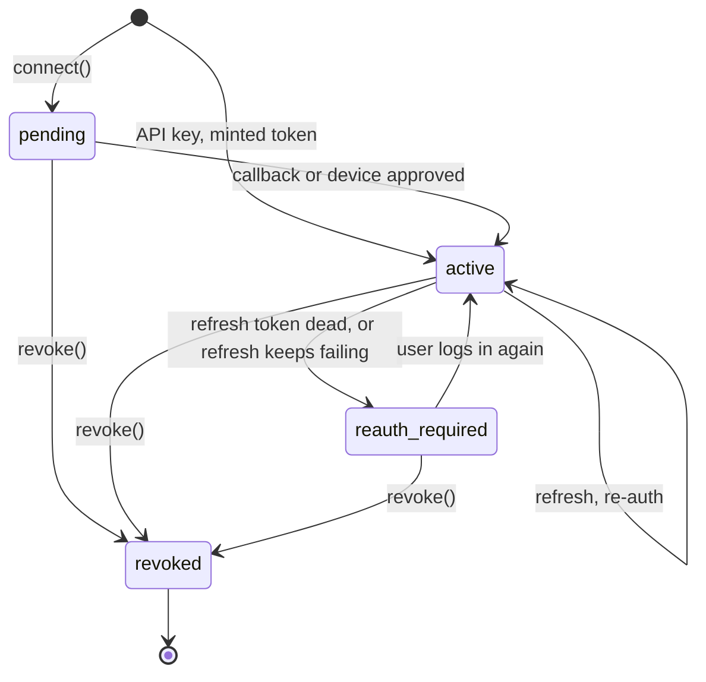
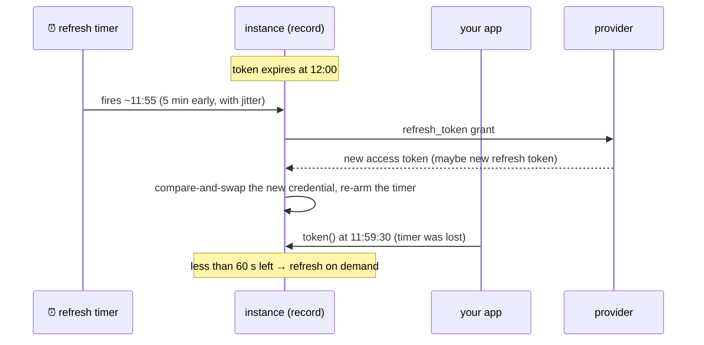

A connection is always in exactly one of four states. Every change between them is written atomically together with an event for your app, so your app never misses a transition.

## The state machine



| State | Meaning | `token()` / `fetch` |
| --- | --- | --- |
| `pending` | An authorization was started but hasn't finished. | `409 not_active` |
| `active` | A working credential is stored. | ✅ |
| `reauth_required` | The credential stopped working, and only the user can fix it by logging in again. The old credential is discarded. | `409 not_active` (with `reason`) |
| `revoked` | Ended on purpose. Terminal: the same id can't be connected again. | `409 not_active` |

Every state change emits a `connection.<state>` event: `connection.active`, `connection.reauth_required` and so on. The event carries `{ from, to, reason? }`, so your app can tell a first connect (`from: "pending"` or `null`) from a re-auth (`from: "reauth_required"`).

## Reasons

`reauth_required` and `revoked` carry a `reason`:

| reason | Cause |
| --- | --- |
| `invalid_grant` | The provider says the refresh token is dead: the user revoked access, the password changed, or the token was rotated elsewhere. Definitions map provider-specific codes to it, like GitHub's `bad_refresh_token` with `.deadRefreshToken("bad_refresh_token")`. |
| `refresh_failed` | Refresh kept failing for a transient reason (network, provider 5xx) through every retry. |
| `expired` | The token expired, and there's no way to renew it (no refresh token). |
| `revoked`, or your own | `revoke()` with no reason gives `revoked`. `revoke("user_deleted")` stores yours. |

## How tokens stay fresh

Two paths keep a token valid. Either one alone would do. Together they cover each other's gaps.



- **Scheduled.** When a credential is stored, a durable timer is set for 5 minutes before expiry (at most half the token's lifetime, with a little jitter so connections created together don't refresh together). Failures retry with exponential backoff: 30 s base, 8 attempts, then `reauth_required` with `refresh_failed`.
- **On demand.** `token()`, the proxy and actions check expiry on every use. With under 60 seconds left, they refresh first. If that refresh fails for a transient reason while the old token still works, the old one is used.

### Refresh is single-flight and race-free

Ten concurrent requests that all find the token expiring share **one** refresh call and its result. The new credential is written with compare-and-swap against the credential the refresh started from, so:

- A refresh that loses to a concurrent re-auth or revoke never overwrites it. The newer credential wins.
- With refresh-token rotation, the new refresh token is never dropped. The write is retried until it lands, because losing it would lose the only valid token.

## Re-authorization

When a connection hits `reauth_required`, your app gets `connection.reauth_required`. Ask the user to connect again, with the same link or session as the first time:

```ts
listen("github").on("connection.reauth_required", async (e) => {
  await notifyUser(e.connection.id, "Please reconnect GitHub");
});
```

Connecting again moves it back to `active` with a fresh credential. Webhook subscriptions follow: if the user re-authorizes as a *different* provider account, subscriptions are registered again for the new account.

## The login handshake

Starting OAuth opens a **handshake**: a single-use, signed ticket that becomes the OAuth `state` parameter. It holds the PKCE verifier (and, for OIDC, the nonce) inside the instance, and lives 10 minutes.

- The `state` names its own instance, so `/callback` routes straight to the right connection without a lookup.
- It can be redeemed once. A replayed or forged callback gets `400 unknown or expired state`.
- From a browser session, the callback also checks a cookie set in the browser that started the flow. See [connecting users](/guides/connecting-users/).

## Identity: who the credential belongs to

Before a credential is stored, the definition's `.identity()` runs. In the GitHub provider, it calls `GET /user` and returns `{ id, login }`.

- A throw **rejects the credential**, and the connection doesn't go active. That's how API-key connections validate the key.
- The result becomes `status().metadata`, typed in the SDK.
- `.external()` picks the provider ids to **index** (GitHub `id`, Slack `teamId`, Google `sub`), for `oc.connections.list({ external })` and for routing app-wide webhooks.

## Next

- [Architecture](/concepts/architecture/): how state, timers and outboxes are built underneath.
- [Events](/guides/events/): receiving `connection.*` in your app.
