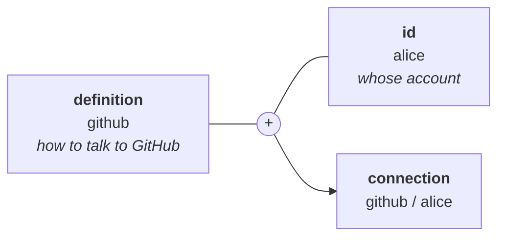
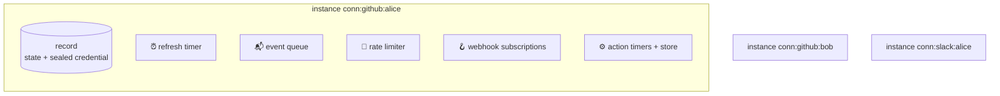
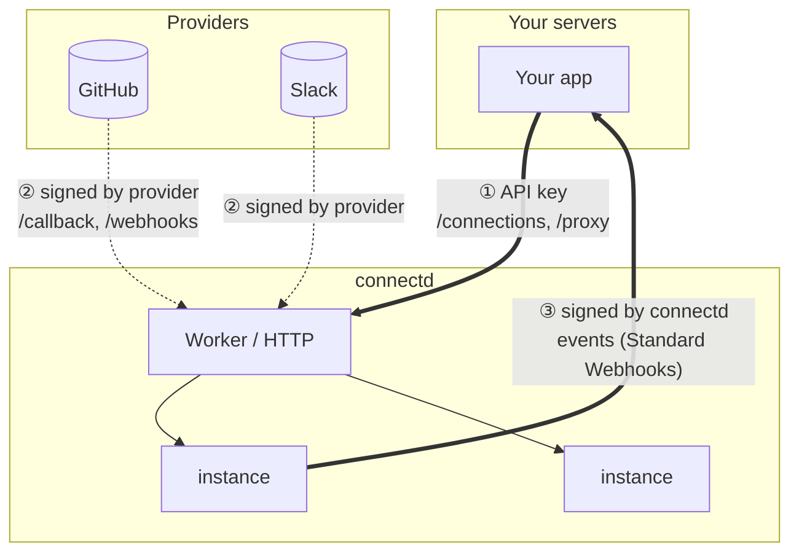
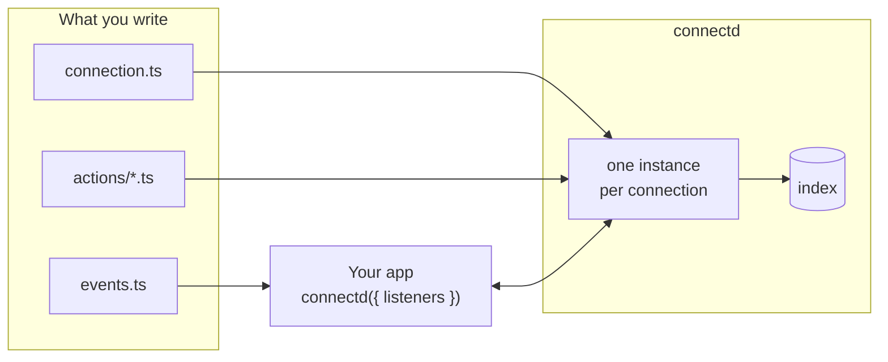

Five ideas cover almost everything connectd does.

## 1. A connection is a definition plus an id

- The **definition** is code you own: endpoints, scopes, how to refresh, how to verify webhooks, who the token belongs to. One per provider, in `src/oc/<id>/connection.ts`.
- The **id** is your choice, usually your user's id. A user with two GitHub accounts gets `alice:work` alongside `alice`.

Your app never deals with tokens. It names a connection, `oc.connection("github", "alice")`, and asks it to do things.

## 2. Each connection is its own small server

Every connection runs as an isolated **instance**: a tiny actor with its own storage, its own timers and its own place in line. On Cloudflare, each instance is one Durable Object. In `connectd dev`, it's an entry in memory.

This one decision explains a lot:

- **No shared token table.** Each credential lives, encrypted, inside its own instance. Nothing else can read it.
- **No cross-user races.** Alice's refresh never waits on Bob's. Inside one instance, every change goes through a compare-and-swap, so two concurrent refreshes can't step on each other.
- **Timers belong to the connection.** "Refresh this token in 55 minutes" and "renew this webhook tomorrow" are durable alarms on that instance. They fire even if nobody calls.
- **It scales out naturally.** A million connections are a million small instances, not one big locked table.

## 3. Your app talks *to* a connection, never *around* it

Everything your app does goes through the connection, and the connection holds the token:

| You call | What happens inside the instance |
| --- | --- |
| `gh.status()` | Reads state and identity: `{ state: "active", metadata: { login } }` |
| `gh.fetch("/user/repos")` | Gets a fresh token (refreshing if due), takes a rate-limit permit, and the request goes to GitHub with the token added |
| `gh.actions.profile()` | Runs your action code *next to* the token, with an authenticated `api` |
| `gh.connect()` / `oc.routes` | Starts OAuth: a signed handshake, PKCE, redirect |
| `gh.revoke()` | Removes webhooks, revokes at the provider, marks the connection revoked |
| `gh.token()` | The escape hatch: hands you the credential (avoid it if you can) |

## 4. Traffic flows in three directions, each with its own trust

1. **App → connectd.** Your backend calls with `Authorization: Bearer <CONNECTD_API_KEY>`. The browser never gets this key. It gets short-lived [session tokens](/guides/connecting-users/) scoped to one connection instead.
2. **Provider → connectd.** OAuth callbacks carry a signed `state` that names their instance, so no lookup is needed. Webhooks are verified by the definition's own `verify` before anything reaches a connection.
3. **connectd → app.** [Events](/guides/events/) are POSTed to your app, signed with `CONNECTD_EVENTS_SECRET`, in order per connection, and retried until your app answers 2xx.

## 5. The definition describes; the runtime does

A definition is mostly data and small functions: which URLs, which scopes, what's odd about this provider. It never touches storage, timers or keys. It gets a narrow `ctx` (config, fetch, redirect URI, clock) and returns values.

The runtime does everything stateful: sealing, retrying, scheduling, delivering. That split is what lets the **same connection file** run unchanged in:

- `connectd dev` (in memory, on your laptop),
- your own Cloudflare account (`connectd deploy`),
- the planned managed service,
- tests, against fake providers.

It also means a bug in a definition can't corrupt state. Definition code always runs *before* the runtime writes, so a throw leaves the record exactly as it was.

## Putting it together

- `connection.ts` and `actions/` run **inside connectd**, in the connection's instance.
- `events.ts` runs **in your app**. The CLI collects every folder's listeners into `.connectd/app.ts` for the client.
- The **index** is a searchable copy of every connection's state and external ids, for listing (`oc.connections.list()`) and for routing app-wide webhooks. Nothing secret is copied into it.

## Next

- [The connection lifecycle](/concepts/lifecycle/): the states a connection moves through, and why.
- [Architecture](/concepts/architecture/): the layers underneath, from drivers to the SDK.
