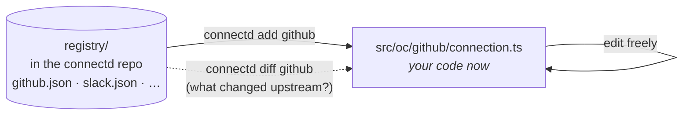

connectd has a catalog of providers (GitHub, GitHub App, Slack and Google so far), but you never `import` it. `connectd add` **copies** a provider into your project as plain source, the way shadcn/ui copies components.



```sh
npx connectd add              # list the catalog
npx connectd add github       # copy it into src/oc/github/
npx connectd add github --id gh   # copy it as src/oc/gh/ (connection id "gh")
npx connectd diff github      # later: a unified diff against the catalog's current version
```

The copied file starts with a header that records its origin:

```ts
// connectd: github@0.0.0. Copied by `connectd add`; yours to edit. `connectd diff github` shows what changed upstream.
```

## Why copy instead of import

**Auth code is where surprises hurt most.** If providers were a package, `npm update` could change how your users' tokens are refreshed or revoked, silently, under a running app. Copied code changes only when you change it.

**Every provider has quirks, and so does every app.** You'll want different scopes, an extra authorize parameter, a different identity call, or one more webhook topic. With an imported provider each of those needs a config flag someone else has to add. With copied code it's a one-line edit.

**Custom and catalog connections are the same thing.** A connection you wrote yourself and one you copied are both a `connection()` builder in `src/oc/<id>/connection.ts`. Same tools, same tests, same everything. There's no "escape hatch" boundary to cross.

**Reading it is the documentation.** The GitHub file says, in about 100 lines, exactly what connectd does with GitHub: which endpoints, how revocation works, why there's a `user-agent` header, how webhook signatures are checked.

## The id is the folder

A connection's id is its folder's name, not what the file says. `src/oc/gh/connection.ts` exporting the `github` builder runs as `gh`. That's what lets you copy one provider twice, for example two GitHub OAuth apps with different scopes:

```text
src/oc/
├── github/connection.ts          id "github": read:user
└── github-admin/connection.ts    id "github-admin": admin:repo_hook
```

Each reads its own env names, so give the copy different ones (`GITHUB_ADMIN_CLIENT_ID`) in its `.config((env) => …)`.

## Staying up to date

`connectd diff <id>` compares your file against the catalog at your CLI's version and prints a unified diff. Take the changes you want by hand. Your edits are never overwritten. `connectd add <provider> --force` replaces the file if you'd rather start over.

## Providers the catalog doesn't have

```sh
npx connectd add --custom my-crm --template oauth2
```

This writes the same folder from a template, with `example.com` URLs marking what to fill in. There's a template for every flow: `oauth2` (the default), `oidc`, `api-key`, `client-credentials`, `jwt-bearer` and `device`. See [custom providers](/extending/custom-providers/), and consider [contributing it to the catalog](/contributing/providers/).
