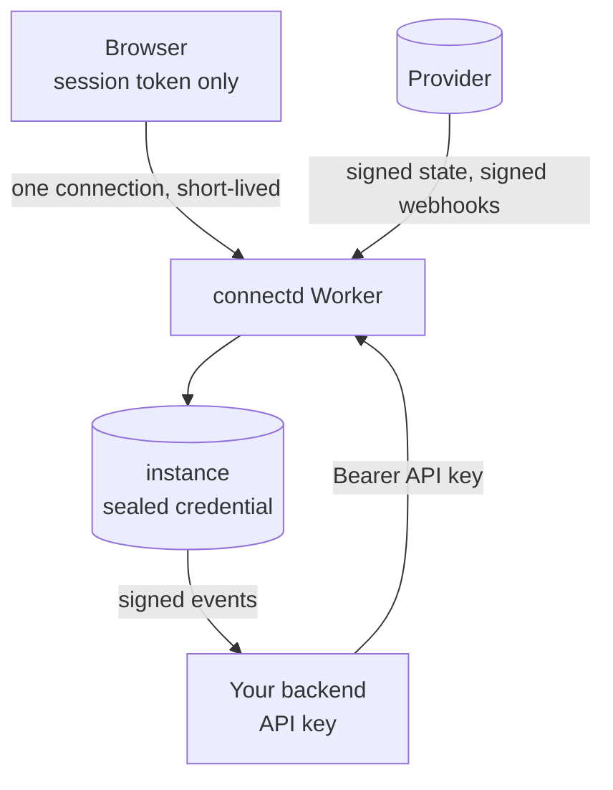
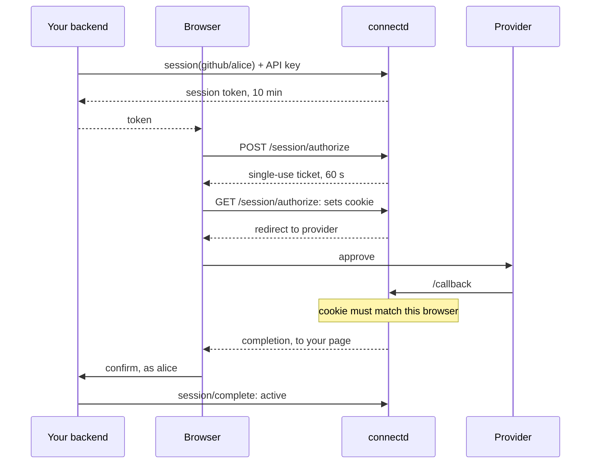

connectd holds your users' credentials for other services, so its design starts from the trust boundaries.

## Keys

One **root key** per project, `CONNECTD_ROOT_KEY`. `connectd init` makes it once and it never changes. It stays with the CLI: in your `.env`, a teammate's, a CI secret. It never goes over the network and no deployment holds it.

Every key a deployment holds is **derived** from it, per environment: `HMAC-SHA256(root, "connectd/<environment>/<purpose>")`. A deploy from any machine with the root key sends the same values, staging's can't be computed from production's, and a deleted Worker comes back with the keys that open what it sealed.

| Name | Used for |
| --- | --- |
| `CONNECTD_KEY_V1`, `_V2`, … | Encrypting credentials (AES-GCM). Versions run from `V0` to `V255`; the highest is current. |
| `CONNECTD_STATE_KEY` | Signing OAuth `state` and other single-use tickets |
| `CONNECTD_SESSIONS_KEY` | Signing browser session tokens |
| `CONNECTD_WEBHOOKS_KEY` | Deriving each connection's own webhook secret |
| `CONNECTD_ADMIN_KEY` | Signing CLI requests to `/admin`, dashboard sign-in links, invites and session cookies |

Your app's credentials are in the deployment's **database**, not its environment, so the CLI (`connectd keys`) and the dashboard manage them while it runs:

| | |
| --- | --- |
| **API keys** (`ock_<id>_<secret>`, your app's `CONNECTD_API_KEY`) | Only the secret's SHA-256 is stored. As many as you need, one per service. |
| **Events secrets** (`whsec_…`, your app's `CONNECTD_EVENTS_SECRET`) | Stored sealed. Events are signed with every live one. |

Both are shown once. **Roll** gives a key a new secret and keeps the old one working for a grace period you choose (events carry a signature from each, so a delivery never fails a check mid-rotation). **Revoke** ends it. An isolate trusts a key it has looked up for up to 30 seconds, so a revoke reaches every isolate within that.

Your app needs only `CONNECTD_URL`, `CONNECTD_API_KEY` and `CONNECTD_EVENTS_SECRET`. The rest never leave connectd. A leaked root key exposes every environment of the project and can't be replaced without a new project, so keep it like any master secret.

## Credentials at rest

- Every credential is **sealed** (AES-GCM, with a key-version byte) before it's written, and only inside its own instance.
- **Key rotation without migration.** `connectd deploy --rotate key` adds `CONNECTD_KEY_V<n+1>` (derived, like V1). New writes use it. Values sealed under an older key are re-sealed the next time they're read, so old keys can be removed once traffic has passed through.
- The connection **index** holds state and external ids (like a GitHub user id), never credentials. Webhook registrations are stored unsealed, so they must hold ids only. That's part of the definition contract.

## Definition code is sandboxed by interface

A definition's functions get a narrow `ctx`: `config`, `fetch`, `redirectUri`, `now`. They never see the platform, the encryption keys or other connections, and the kernel performs every write. A definition that throws leaves state untouched.

That's isolation by API inside one isolate. A definition can still burn CPU or hang until workerd's limits stop it. It's your own code, so that's the right trade for self-hosting.

## Your backend → connectd

- All routes except `/callback`, `/webhooks`, `/session`, `/admin` and the dashboard page require `Authorization: Bearer <CONNECTD_API_KEY>`: a live API key from the database, its secret compared by digest. A dashboard session works there too.
- `/admin` (keys) takes a CLI request, `Authorization: Admin <token>`: signed with the admin key, valid 60 seconds and used once. Or a dashboard session. Never an API key.
- The proxy refuses paths that climb out of `/proxy/:def/:id/`, both in the SDK and in the runtime, so a crafted path can't turn the proxy into a call to the admin API.
- Internal methods (`kernel.*`, extension-internal ones) can't be called over HTTP.

## Browsers: sessions, never the API key

Connecting a user from a browser is the riskiest flow. A plain "connect URL" that isn't tied to a browser allows **login CSRF**: an attacker starts a flow, sends the link to a victim, and the victim's provider account lands on the attacker's connection (or the other way round). connectd's sessions close that:

- A **session token** can start and confirm one connection's authorization, from the exact origins in `sessions.origins`, and nothing else: no `token()`, no proxy.
- The **binding cookie** means the callback only completes in the browser that started the flow.
- The credential isn't activated at the callback. It waits, sealed, until **your app's page confirms** it for the signed-in user. Whoever started a flow can't finish it for someone else.
- With `oc.routes`, connect links only work from your app's own pages (`Sec-Fetch-Site`), and user ids can't contain `:` (it separates a user from their extra accounts).

`oc.connection(def, id).connect()` still returns a raw provider URL for server-side flows. Don't send it to a browser. Use `oc.routes` or a session instead.

## The dashboard

The dashboard holds no key. Its first sign-in is a link `connectd dashboard` signs with the admin key: valid 5 minutes, used once, carried in the URL fragment (never sent to a server log or a `Referer`) and dropped from the URL once read. It gives a one-hour root session, and the dashboard asks for an account.

- **Accounts** sign in with a **passkey** (WebAuthn: ES256 or RS256, bound to the deployment's origin and host, the signature counter checked against cloned keys) or a **password** (PBKDF2-SHA256, 100,000 iterations, workerd's limit). Sign-ins are rate limited per username. An account can't remove its last way in.
- **Sessions** are an `HttpOnly`, `SameSite=Strict` cookie (`Secure` off localhost) for 12 hours, naming the account's session generation: *sign out everywhere* ends them all. A request that changes something must also carry this deployment's `Origin`.
- **Invites** are one-time links, valid 72 hours.
- The page's CSP allows only its own script; style also by a per-page nonce (the UI library's scroll lock).

## Providers → connectd

- **OAuth callbacks.** `state` is a signed, single-use, 10-minute ticket naming its instance, and PKCE is on by default. For OIDC, the id_token's signature, issuer, audience, expiry and nonce are checked.
- **Webhooks.** Each definition's `verify` checks the provider's signature before anything reaches a connection. Per-connection webhooks (GitHub repo hooks) use a secret derived for that connection alone, and app-wide ones (Slack) use the app's signing secret from config. Replays outside the provider's tolerance window are refused where the provider supports it.

## connectd → your app

Events follow [Standard Webhooks](https://www.standardwebhooks.com): `webhook-id`, `webhook-timestamp` and `webhook-signature` (`v1,<HMAC-SHA256>`). The SDK verifies the signature and a 5-minute timestamp window before any handler runs. Any Standard Webhooks library can verify them too. See [events](/guides/events/).

## Deploy hygiene

- `connectd init` makes `.env` owner-only (`0600`), adds it to `.gitignore`, and refuses to write the root key into a `.env` that git already tracks.
- `connectd deploy` sends only the env names your project actually reads plus the derived keys, refuses dev's values, and never sends the root key.
- In CI, the root key is a CI secret. The app's API key is made on the first deploy and printed once; later ones come from `connectd keys`.
