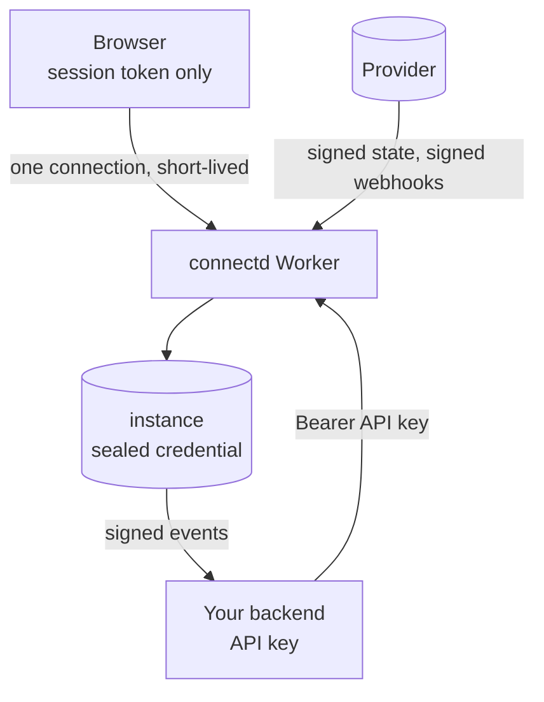
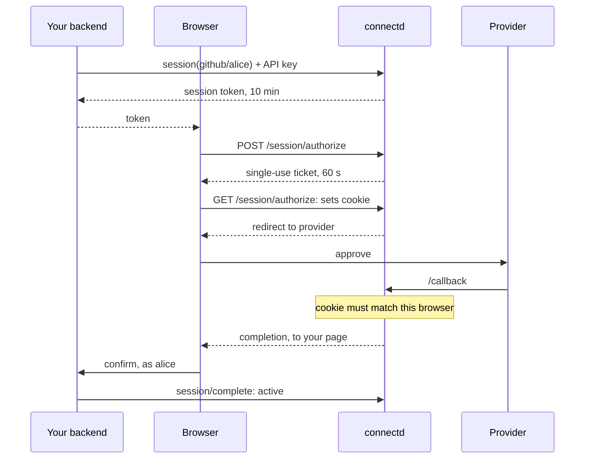

connectd holds your users' credentials for other services, so its design starts from the trust boundaries.

## Keys

Each deployment (dev, staging, production) has its own set. `connectd init` writes dev's to `.env`, and `connectd deploy --env <name>` generates the others' as Worker secrets.

| Name | Used for |
| --- | --- |
| `CONNECTD_API_KEY` | Your backend → connectd. Bearer token on every non-public route. |
| `CONNECTD_KEY_V1`, `_V2`, … | Encrypting credentials (AES-GCM). The highest version is current. |
| `CONNECTD_STATE_KEY` | Signing OAuth `state` and other single-use tickets |
| `CONNECTD_SESSIONS_KEY` | Signing browser session tokens |
| `CONNECTD_WEBHOOKS_KEY` | Deriving each connection's own webhook secret |
| `CONNECTD_EVENTS_SECRET` | Signing events to your app (`whsec_…`, Standard Webhooks) |

Your app needs only `CONNECTD_URL`, `CONNECTD_API_KEY` and `CONNECTD_EVENTS_SECRET`. The rest never leave connectd.

## Credentials at rest

- Every credential is **sealed** (AES-GCM, with a key-version byte) before it's written, and only inside its own instance.
- **Key rotation without migration.** `connectd deploy --rotate key` adds `CONNECTD_KEY_V<n+1>`. New writes use it. Values sealed under an older key are re-sealed the next time they're read, so old keys can be removed once traffic has passed through.
- The connection **index** holds state and external ids (like a GitHub user id), never credentials. Webhook registrations are stored unsealed, so they must hold ids only. That's part of the definition contract.

## Definition code is sandboxed by interface

A definition's functions get a narrow `ctx`: `config`, `fetch`, `redirectUri`, `now`. They never see the driver, the encryption keys or other connections, and the kernel performs every write. A definition that throws leaves state untouched.

That's isolation by API inside one isolate. A definition can still burn CPU or hang until workerd's limits stop it. It's your own code, so that's the right trade for self-hosting.

## Your backend → connectd

- All routes except `/callback`, `/webhooks`, `/session`, `/connect` and the dashboard page require `Authorization: Bearer <CONNECTD_API_KEY>`. The key is compared by digest, so the comparison leaks no timing.
- The proxy refuses paths that climb out of `/proxy/:def/:id/`, both in the SDK and in the runtime, so a crafted path can't turn the proxy into a call to the admin API.
- Internal methods (`kernel.*`, extension-internal ones) can't be called over HTTP.

## Browsers: sessions, never the API key

Connecting a user from a browser is the riskiest flow. A plain "connect URL" that isn't tied to a browser allows **login CSRF**: an attacker starts a flow, sends the link to a victim, and the victim's provider account lands on the attacker's connection (or the other way round). connectd's sessions close that:

- A **session token** can start and confirm one connection's authorization, from the exact origins in `sessions.origins`, and nothing else: no `token()`, no proxy.
- The **binding cookie** means the callback only completes in the browser that started the flow.
- The credential isn't activated at the callback. It waits, sealed, until **your app's page confirms** it for the signed-in user. Whoever started a flow can't finish it for someone else.
- With `oc.routes`, connect links only work from your app's own pages (`Sec-Fetch-Site`), and user ids can't contain `:` (it separates a user from their extra accounts).

`oc.connection(def, id).connect()` still returns a raw provider URL for server-side flows. Don't send it to a browser. Use `oc.routes` or a session instead.

## Providers → connectd

- **OAuth callbacks.** `state` is a signed, single-use, 10-minute ticket naming its instance, and PKCE is on by default. For OIDC, the id_token's signature, issuer, audience, expiry and nonce are checked.
- **Webhooks.** Each definition's `verify` checks the provider's signature before anything reaches a connection. Per-connection webhooks (GitHub repo hooks) use a secret derived for that connection alone, and app-wide ones (Slack) use the app's signing secret from config. Replays outside the provider's tolerance window are refused where the provider supports it.

## connectd → your app

Events follow [Standard Webhooks](https://www.standardwebhooks.com): `webhook-id`, `webhook-timestamp` and `webhook-signature` (`v1,<HMAC-SHA256>`). The SDK verifies the signature and a 5-minute timestamp window before any handler runs. Any Standard Webhooks library can verify them too. See [events](/guides/events/).

## Deploy hygiene

- `connectd init` makes `.env` owner-only (`0600`), adds it to `.gitignore`, and refuses to write keys into a `.env` that git already tracks.
- `connectd deploy` sends only the env names your project actually reads, and refuses dev's values and generated dev keys.
- In CI, deploy never generates or prints an API key. It comes from a CI secret (`connectd keys`).
