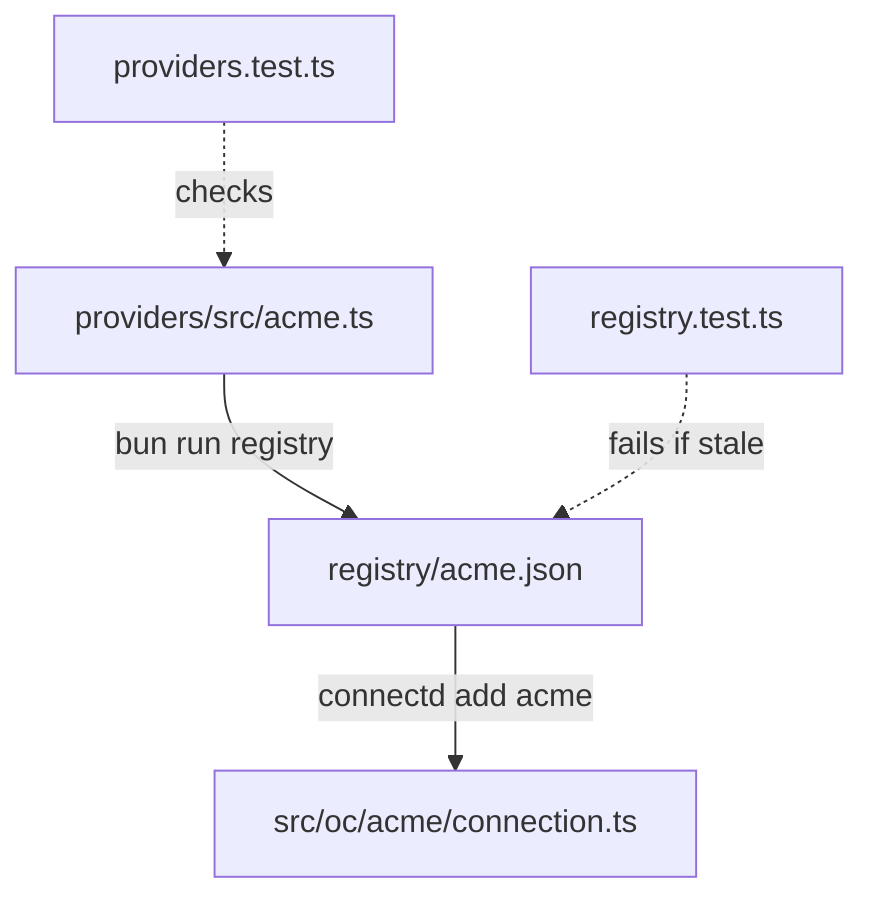

The catalog's source is `packages/providers/src/`, one file per provider. `bun run registry` turns it into `registry/*.json`, which `connectd add` fetches at the CLI's version tag.



## 1. Write the connection

```ts title="packages/providers/src/acme.ts"
import { connection, type OAuth2Config, rateHeaders } from "@kavishkagaya/connectd/connections";

/**
 * Acme. What's unusual about it: …
 */
export const acme = connection("acme")
  .config<OAuth2Config>((env) => ({ clientId: env("ACME_CLIENT_ID"), clientSecret: env("ACME_CLIENT_SECRET") }))
  .auth((f) => f.oauth2({ authorizeUrl: "https://acme.com/oauth/authorize", tokenUrl: "https://acme.com/oauth/token" }).scopes("read"))
  .api({ baseUrl: "https://api.acme.com/v1" })
  .observe((res, now) => rateHeaders(res, now))
  .identity(async ({ api }) => {
    const me = await api.get<{ id: number; name: string }>("/me");
    return { id: String(me.id), name: me.name };
  })
  .external((me) => ({ id: me.id }));
```

Guidelines:

- **Import only `@kavishkagaya/connectd/connections`.** The file is copied into users' apps as is.
- **Read config from env** with `.config((env) => …)`, using `<PROVIDER>_CLIENT_ID`-style names. Use `env.optional` for extras.
- **Comment the quirks.** The doc comment at the top should say what's unusual, and why each override exists. Users read this file.
- **Mark known limits** with `// ponytail:`, naming the limit and the upgrade path.
- **Webhook `hook` values hold ids only.** They're stored unsealed.

## 2. Export it and add it to the catalog

```ts title="packages/providers/src/index.ts"
export { acme } from "./acme.ts";
```

```ts title="packages/providers/src/registry.ts"
const CATALOG = [
  // …
  { file: "acme", name: "acme", c: acme, description: "Acme OAuth: projects API, project webhooks" },
];
```

## 3. Test it against a fake

Add a test to `providers.test.ts` that drives the real flow with `fakeOAuth` and `harness` from `@kavishkagaya/connectd-connections/testing`. Cover what's specific to the provider: the authorize URL's parameters, the token response shape, refresh and rotation, the dead-refresh code, revocation, identity, and webhook verify and parse. See [testing connections](/extending/custom-providers/#testing).

```sh
cd packages/providers && bun test
```

## 4. Regenerate the registry

```sh
cd packages/providers && bun run registry
```

This writes `registry/acme.json` (the source plus `export default acme`, its env names, the version) and updates `registry/index.json`. Commit both, because `registry.test.ts` fails when they're stale.

## 5. Try it in an example

```sh
cd examples/basic
bunx connectd add acme --registry ../../registry
bun run dev
```

Then open a PR with `Closes #<issue>` if there's one. If the provider needed a new builder feature, that's a design change, so open an issue for it first.
