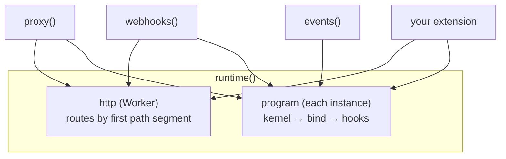

The proxy, events, webhooks, sessions and the dashboard are all **extensions**. They use the same API that's open to you, so anything they do, your extension can do too.



## The shape

```ts
import type { Extension } from "@kavishkagaya/connectd/runtime";

type Extension = {
  /** Worker routes, keyed by first path segment: { audit: … } serves /audit/*. API key required unless public. */
  routes?: Record<string, { public?: boolean; fetch(req: Request, api: Api, path: string[]): Promise<Response> }>;
  /** Per connection: called once per instance, next to the lifecycle. */
  connection?(h: Hosted): {
    methods?: Record<string, (args: Json) => Promise<Json>>;  // POST /connections/:def/:id/<method>
    after?(cause: string): Promise<void>;                      // after every method or timer
    beforeRevoke?(): Promise<void>;                            // while the credential still works
  };
  /** Methods only your own routes may call (refused over /connections). */
  internal?: string[];
};
```

What a connection looks like from inside (`Hosted`):

| Field | What it is |
| --- | --- |
| `h.k` | The instance's **kernel**: declare cells, timers, queues, tickets and limiters on it |
| `h.def`, `h.id`, `h.instance` | The definition, the connection id, and `conn:<def>:<id>` |
| `h.bound` | The running connection: `token()`, `conn.read()`, `metadata()`, `ctx` |
| `h.settings` | The deployment's settings: URLs, events, sessions, connector config |

## Example: a usage counter

Count proxied calls per connection, expose the count as a method, and serve a summary route:

```ts title="src/usage.ts"
import type { Extension } from "@kavishkagaya/connectd/runtime";
import { instanceOf } from "@kavishkagaya/connectd/runtime";

export function usage(): Extension {
  return {
    routes: {
      // GET /usage/:def/:id  (API key required: not public)
      usage: {
        async fetch(req, api, [def, id]) {
          if (!def || !id) return Response.json({ error: "usage/:def/:id" }, { status: 404 });
          const r = await api.call(instanceOf(def, id), "usage.get", null);
          return Response.json("ok" in r ? r.ok : r.error, { status: "ok" in r ? 200 : r.error.status });
        },
      },
    },
    connection: (h) => {
      // Stored names are claimed once per instance; prefix them with your extension's name.
      const count = h.k.cell<{ n: number; since: number }>("usage.count");
      return {
        methods: {
          "usage.get": async () => (await count.read())?.value ?? { n: 0, since: h.k.now() },
        },
        async after(cause) {
          if (cause !== "proxy.prepare") return;
          await count.update((cur) => ({ n: (cur?.n ?? 0) + 1, since: cur?.since ?? h.k.now() }));
        },
      };
    },
  };
}
```

Add it in the config:

```ts title="oc.config.ts"
import { usage } from "./src/usage";

export default defineConfig({
  // …
  extensions: [usage()],   // after the built-in ones
});
```

```ts title="your app"
await oc.connection("github", "alice").call("usage.get");   // { n: 42, since: … }
```

## Rules of the road

- **Declare once, at setup.** Call `h.k.cell(…)`, `h.k.timer(…)` and so on inside `connection(h)`, never inside a method. A stored name declared twice throws at startup. Use names like `<extension>.<name>`, with letters, digits and `_ . -`.
- **Everything that races goes through `cell.update`.** Handlers interleave at every `await`. `update(f)` re-runs `f` on fresh data until its compare-and-swap lands. Keep `f` synchronous and free of side effects.
- **Timers are nudges.** Timer and cell writes aren't atomic. Make every timer-driven job also reachable on demand (from `after`, or the next method call), and re-check state in the handler.
- **Time is `h.k.now()`**, never `Date.now()`, so tests can move the clock.
- **Args and results are JSON.** Errors cross as data: throw `new Fail(code, status, message)` (exported from `@kavishkagaya/connectd/runtime`) for a clean HTTP error.
- **Built-ins win.** A method or route name that clashes with a built-in one is shadowed.
- **Emitting events:** `emit(h, data, type)` from `@kavishkagaya/connectd/runtime` queues an event on the connection, ordered after its lifecycle events.

## Kernel tools at a glance

```ts
const c = h.k.cell<V, Msg>("ext.name", { ttlMs? });   // read / update(f) / put / delete / take / outbox
const t = h.k.timer<P>("ext.timer", { handle(p, { attempt }), retry?: { baseMs, maxMs?, maxAttempts }, giveUp? });
const q = h.k.queue<M>("ext.queue", { deliver(m) /* null = ok, string = why it failed */, retry?, max?, keep? });
const tk = h.k.ticket<D>("ext.ticket", { ttlMs });     // issue(data) → signed string; redeem(t) once
const l = h.k.limiter("ext.limit", { count, periodMs }); // GCRA; h.k.limiter.at("app:x", …) lives in another instance
const v = await h.k.acquire([l]);                      // all or nothing: { ok } or { ok: false, retryAfterMs }
await h.k.refund([l]);                                 // give permits back; l.observe({ remaining, resetAt }) tightens
const f = h.k.flight<T>();                             // single-flight, in memory
const m = h.k.mutex();                                 // one at a time, in memory
const sealed = await h.k.seal(json); const { value } = await h.k.unseal(sealed);
```

The [architecture page](/concepts/architecture/#l1--kernel-mechanism-never-policy) explains each guarantee.

## Deploy targets

`target` in the config is data: `{ adapter: "<module>", options }`. `connectd deploy` imports the adapter module at deploy time (in Node, never in the Worker) and calls its `deploy(ctx)`:

```ts
import type { Adapter, DeployContext, Deployed } from "@kavishkagaya/connectd";

export const deploy: Adapter["deploy"] = async (ctx: DeployContext): Promise<Deployed> => {
  // ctx.project: the resolved project; ctx.entry: the module to bundle as the config
  // ctx.secrets: env names → values to set; ctx.environment, ctx.ci, ctx.dryRun, ctx.rotate
  // ctx.summary: plan lines to print
  return { name: "my-app", url: "https://…", dryRun: ctx.dryRun };
};
```

`@kavishkagaya/connectd-cloudflare` is the reference implementation: it generates the Worker entry, `wrangler.json` and migrations, then runs wrangler. A target for another platform also needs a [driver](/extending/self-hosting/#writing-a-driver) for it.
