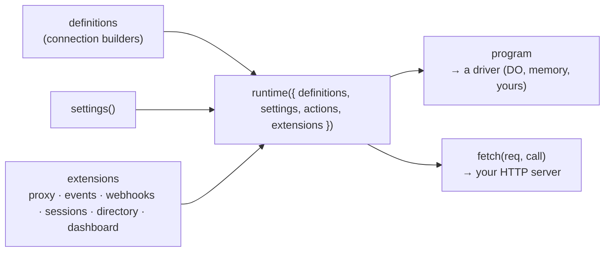

The CLI is a convenience. Underneath, everything is one function, `runtime()`, plus a driver. Use it directly when you want full control: your own Worker with other routes, a custom settings source, or a platform the CLI doesn't target.



## On Cloudflare, by hand

```ts title="worker.ts"
import { env } from "cloudflare:workers";
import { importHmacKey, importKeys } from "@kavishkagaya/connectd/kernel";
import { directory, events, proxy, runtime, sessions, webhooks } from "@kavishkagaya/connectd/runtime";
import { cloudflare, d1Index } from "@kavishkagaya/connectd/runtime/cloudflare";
import github from "./oc/github/connection.ts";

const rt = runtime({
  definitions: { github },
  // Loaded once per isolate, lazily: Workers can't do crypto at global scope.
  settings: async () => ({
    keys: await importKeys({ 1: env.CONNECTD_KEY_V1 }, 1),
    stateKey: await importHmacKey(env.CONNECTD_STATE_KEY),
    apiKey: env.CONNECTD_API_KEY,
    redirectUri: "https://connect.example.com/callback",
    config: { github: { clientId: env.GITHUB_CLIENT_ID, clientSecret: env.GITHUB_CLIENT_SECRET } },
    events: { url: "https://app.example.com/api/connectd/events", secret: env.CONNECTD_EVENTS_SECRET },
    webhooks: { url: "https://connect.example.com/webhooks", key: await importHmacKey(env.CONNECTD_WEBHOOKS_KEY) },
    sessions: { key: await importHmacKey(env.CONNECTD_SESSIONS_KEY), origins: ["https://app.example.com"] },
  }),
  extensions: [proxy(), events(), webhooks(), sessions(), directory(d1Index("INDEX"))],
});

const cf = cloudflare(rt, { binding: "CONNECTION" });
export class Connection extends cf.ConnectionDO {}
export default { fetch: cf.fetch };
```

```json title="wrangler.json"
{
  "name": "my-connectd",
  "main": "worker.ts",
  "compatibility_date": "2026-10-01",
  "durable_objects": { "bindings": [{ "name": "CONNECTION", "class_name": "Connection" }] },
  "migrations": [{ "tag": "v1", "new_sqlite_classes": ["Connection"] }],
  "d1_databases": [{ "binding": "INDEX", "database_name": "my-connectd-index", "database_id": "…", "migrations_dir": "node_modules/@kavishkagaya/connectd/runtime/migrations" }]
}
```

Leaving out an extension turns its feature off. Each built-in one is also a no-op until its settings are present (no `events` setting, no deliveries). Using `connectd deploy --dry-run` and reading `.connectd/deploy/` is a quick way to see a working Worker entry and config.

### Settings

| Field | Needed for |
| --- | --- |
| `keys` | Sealing credentials. `importKeys({ 1: k1, 2: k2 }, 2)`: the second argument is the current version. |
| `stateKey` | OAuth `state` and tickets |
| `apiKey` | Bearer auth on non-public routes |
| `redirectUri` | `<public URL>/callback`, registered with providers |
| `config` | Connector config per definition id. `null` for definitions without config (API keys). |
| `events?` | `{ url, secret }`: event delivery |
| `webhooks?` | `{ url, key }`: the ingress URL, and the key per-connection secrets derive from |
| `sessions?` | `{ key, origins }`: the browser connect UI |
| `fetch?` | Outbound fetch for definitions (tests pass a fake) |

Unlike the CLI, `runtime()` doesn't read `.config((env) => …)` for you. Pass each connection's config in `settings.config`. Or use `options(config, env, index)` from `@kavishkagaya/connectd`, which is exactly what the generated Worker does: it resolves an `oc.config.ts` against an env and returns everything `runtime()` takes.

## On a Node server, in memory

The memory driver isn't durable on its own, but `dump()` and `snapshot` save and restore it. That's how `connectd dev` works:

```ts
import { createServer } from "node:http";
import { memory } from "@kavishkagaya/connectd/kernel/memory";
import { memoryIndex, runtime /* , … */ } from "@kavishkagaya/connectd/runtime";

const rt = runtime({ definitions, settings, extensions: [/* …, */ directory(memoryIndex())] });
const world = memory(rt.program, { clock: Date.now });   // real clock: timers fire on their own

// Any Request → Response server works; this is the whole bridge:
const handle = (req: Request) => rt.fetch(req, (instance, method, args) => world.call(instance, method, args));
```

Keep it to dev, demos and tests. Production wants a durable driver.

## Writing a driver

A driver is the [L0 contract](/concepts/architecture/#l0--drivers-infrastructure-only): per-instance `store` (`get`, `put`, `cas`, `take`, `delete`, optional TTL), named durable `timer`s, `call` to another instance, and `now()`. Then expose it as a host for `Program`s:

```ts
import type { Driver, Program } from "@kavishkagaya/connectd/kernel";

// Your platform's equivalent of "one actor per key, with storage and an alarm".
export function myDriver(program: Program) { /* create a Driver per instance, route calls and timer fires to program(driver, instance) */ }
```

Two properties matter most:

- **Each store operation is atomic** against other events on the same instance. `cas` compares versions, so there's no ABA problem.
- **Timers survive restarts** and fire roughly on time, with at least one delivery.

Prove it with the shared parity suite, the same one the memory and Durable Object drivers pass:

```ts
import { parity, probe } from "@kavishkagaya/connectd-kernel/parity";
import { expect, test } from "vitest";

parity("my driver", () => makeWorld(myDriver(probe)), { test, expect });
```

A Postgres or SQLite-backed server driver is on the roadmap. If you'd like to build it, see [contributing](/contributing/overview/).
