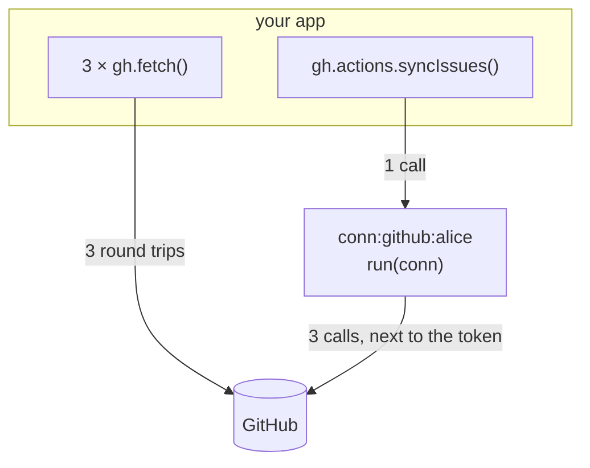
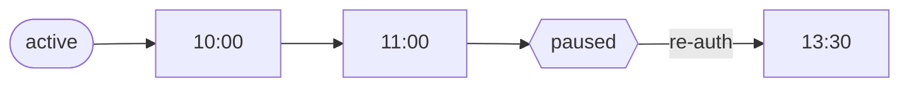

An **action** is a function that runs *inside* the connection's instance, next to its token, with an authenticated API client. A connection's actions live in one file in its folder, `actions.ts`, as an object keyed by name:

```ts title="src/oc/github/actions.ts"
import { action, actions } from "@kavishkagaya/connectd/connections";
import { z } from "zod";

export default actions({
  starRepo: action({
    input: z.object({ repo: z.string() }),
    run: async ({ api }, { repo }) => {
      const res = await api.fetch(`/user/starred/${repo}`, { method: "PUT" });
      return { starred: res.status === 204 };
    },
  }),
});
```

```ts title="your app"
const r = await oc.connection("github", userId).actions.starRepo({ repo: "octocat/hello-world" });
// r: { starred: boolean }, typed from the action
```

The key is the action's name (`starRepo`), and the folder is its connection. Renaming an action is a code change you can see and search for, and your editor's rename works on it. Input takes any [Standard Schema](https://standardschema.dev) library; these examples use zod (`npm i zod`).

Names are letters, digits, `_` and `-`. `then`, `toJSON`, `status`, `connection`, `webhook` and built-in object names are reserved. `actions()` checks the names and that each value is an `action()` when the file loads.

### Many actions: one file each

Keep `actions.ts` as the list and put each action in its own file. Only the key names it, so the file can be called anything:

```ts title="src/oc/github/actions.ts"
import { actions } from "@kavishkagaya/connectd/connections";
import starRepo from "./actions/star";
import syncIssues from "./actions/sync-issues";

export default actions({ starRepo, syncIssues });
```

An `actions/` folder next to `actions.ts` is only read through these imports. Without an `actions.ts`, an `actions/` folder with action files is the 0.2 layout (each file named its action), and `connectd dev` stops with a message saying how to move it.

## Why actions instead of `fetch`?



- **Fewer round trips.** Multi-step logic runs where the token is.
- **Typed operations.** Input is validated by your schema, and output is typed in the SDK. That's what you hand to an AI agent as a tool.
- **Background work.** `every` and `on` run with no caller at all.
- **Per-connection state.** `conn.store` keeps a sync cursor next to the connection.

## Three kinds of trigger

| Trigger | Declared with | Runs | Result goes to |
| --- | --- | --- | --- |
| Your app calls it | `input?` | On `gh.actions.<name>(input)` | The caller, as the return value |
| A schedule | `every: ms` | Every `ms` while the connection is active | An event: `<name>.completed` or `<name>.failed` |
| A state change | `on: "active"` | Once each time the connection enters that state | An event: `<name>.completed` or `<name>.failed` |

An action with `input` can't also have `every` or `on`: a scheduled run has no caller to provide input.

### Called by your app

```ts title="in actions({ … })"
createIssue: action({
  input: z.object({ title: z.string(), body: z.string().optional() }),
  run: async ({ api }, { title, body }) =>
    (await api.fetch("/repos/me/notes/issues", { method: "POST", body: JSON.stringify({ title, body }) })).json(),
}),
```

- Input that fails the schema → `ConnectdError` with `code: "bad_request"` and `issues`, before any code runs.
- The connection must be active → otherwise `not_active` (409), before any code runs.
- Returning nothing gives `null`.

### On a schedule

```ts title="in actions({ … })"
syncIssues: action({
  every: 3_600_000, // an hour
  run: async ({ api, store }) => {
    const since = (await store.get<string>("since")) ?? new Date(0).toISOString();
    const issues = await api.get<{ updated_at: string }[]>(`/issues?since=${since}&filter=all`);
    if (issues.length) await store.set("since", issues[0]!.updated_at);
    return { count: issues.length };
  },
}),
```



- The first run is `every` ms after the connection becomes active, and then every `every` ms. The minimum is 1000.
- It only runs while the connection is `active`. It pauses on `reauth_required` and resumes after re-auth.
- A failed run is retried (30 s base backoff, 3 attempts), then waits for the next interval. Each failure emits `<name>.failed` with `{ error, attempt }`.
- A lost timer is noticed and re-armed on the next call to the connection.

### When the connection changes state

```ts title="in actions({ … })"
welcome: action({
  on: "active",
  run: async ({ api, identity }) => {
    const repos = await api.get<unknown[]>("/user/repos?per_page=100");
    return { login: identity?.login, repos: repos.length };
  },
}),
```

`on: "active"` runs on the first login and again after each re-auth from `reauth_required`. A login while already active isn't an *entry*, so it doesn't count. Connections already in the state when you deploy the action count as entering it the first time they're seen.

## What `run` gets

```ts
run: async (conn, input) => { … }
```

| Field | What it is |
| --- | --- |
| `conn.api` | `fetch(path, init?)` and `get<T>(path)` against `.api({ baseUrl })`, credential added. It throws if the connection has no `.api()`. |
| `conn.token()` | The current credential, refreshed if due |
| `conn.store` | `get`, `set`, `delete`: JSON values kept per connection, shared by its actions |
| `conn.identity` | The connection's `.identity()` result, or null |
| `conn.config` | The connection's config (client id and so on) |
| `conn.connection` | `{ definition, id }` |
| `conn.emit(name, data)` | Send one of the connection's own events |
| `conn.fetch`, `conn.now()` | Plain fetch, and connectd's clock |

For exact types, annotate it: `run: async (conn: ActionCtx<typeof github>) => …`.

## Emitting your own events

Declare events on the connection, then emit them from actions:

```ts title="connection.ts"
export default connection()
  // …
  .events({ synced: z.object({ count: z.number() }) });
```

```ts title="actions.ts, in syncIssues"
run: async ({ api, emit }) => {
  const issues = await api.get<unknown[]>("/issues");
  await emit("synced", { count: issues.length });   // checked against the schema now
  return { count: issues.length };
}
```

```ts title="events.ts (your app)"
listen("github").on("synced", (e) => console.log(e.data.count));
```

Emits are checked immediately, but **sent only if the run succeeds**, before its `.completed`. A run that throws sends none of them, so a retried run never sends duplicates.

## Status

`gh.call("actions.status")` lists each action's trigger and its next scheduled run. The dashboard shows the same, with a **Run** form generated from the input schema.
