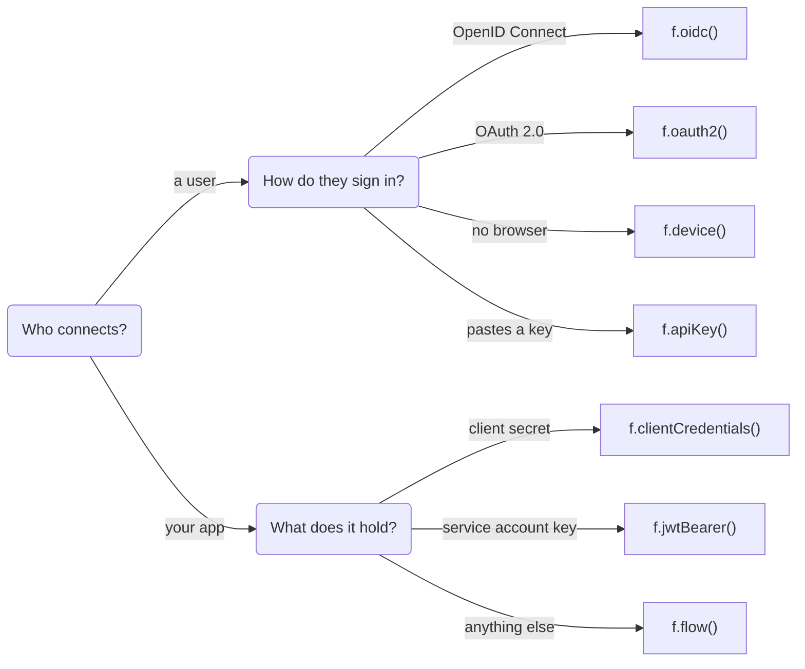
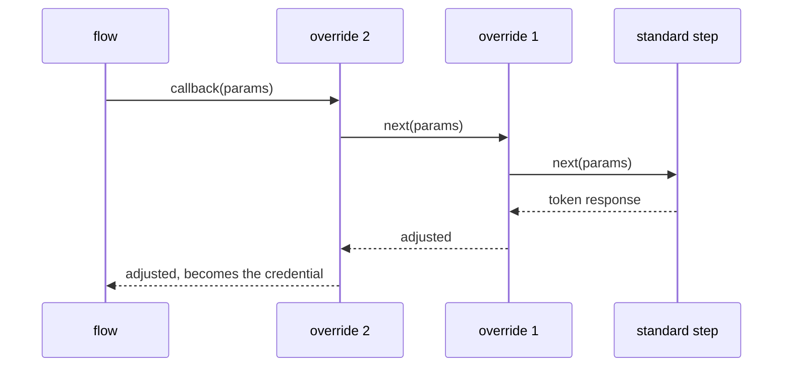

`.auth()` takes a callback that receives the flows, typed for your connection's config:

```ts
.auth((f) => f.oauth2({ authorizeUrl, tokenUrl }).scopes("read:user"))
```

Each flow is a builder: the data goes in the call, and quirks go in methods that return a new flow.

## Which flow?



| Flow | Config type | User involved | Refresh |
| --- | --- | --- | --- |
| `oauth2` | `OAuth2Config` | Browser redirect | Refresh token |
| `oidc` | `OAuth2Config` | Browser redirect | Refresh token |
| `device` | `OAuth2Config` | Types a code on another device | Refresh token |
| `apiKey` | any (often none) | Enters fields in a form | Never expires |
| `clientCredentials` | `OAuth2Config` | None | Minted again |
| `jwtBearer` | `ServiceAccount` | None (or impersonated) | Minted again |
| `flow` | any | You decide | You decide |

## `f.oauth2({ authorizeUrl, tokenUrl, revokeUrl? })`

Authorization code with PKCE.

```ts
.auth((f) =>
  f
    .oauth2({ authorizeUrl: "https://provider.com/oauth/authorize", tokenUrl: "https://provider.com/oauth/token" })
    .scopes("read", "write")          // default scopes (config.scopes and connect({ scope }) win)
    .scopeSeparator(",")              // default " "
    .params({ access_type: "offline", prompt: "consent" })  // extra authorize params
    .params((config) => ({ audience: config.audience }))    // …or from config
    .pkce(false)                      // default on
    .clientAuth("basic")              // or "post": how the client authenticates at the token endpoint
    .deadRefreshToken("bad_refresh_token"),  // provider codes that mean "refresh token is dead"
)
```

With a `revokeUrl`, `revoke()` revokes at the provider (RFC 7009). Without one, revoking is local only, unless you add a `.revoke()` override.

## Overriding one step

Providers bend the standard. Instead of a flag per quirk, you **override a step**. Each override gets the standard step as `next`: call it and adjust the result, or don't call it and replace the step.



There are three steps you can override:

```ts
// Slack: with user scopes only, the user token is nested under authed_user. Lift it up.
.callback(async (ctx, params, next) => lift(await next(params)))
.refresh(async (ctx, cred, next) => lift(await next(cred)))

// GitHub: revocation is DELETE /applications/{client_id}/grant, not RFC 7009.
.revoke(async (ctx, cred) => {
  if (cred.kind !== "oauth2") return;
  const res = await ctx.fetch(`https://api.github.com/applications/${ctx.config.clientId}/grant`, {
    method: "DELETE",
    headers: { authorization: `Basic ${btoa(`${ctx.config.clientId}:${ctx.config.clientSecret}`)}` },
    body: JSON.stringify({ access_token: cred.accessToken }),
  });
  if (!res.ok && res.status !== 404) throw new Error(`revoke ${res.status}`);
})
```

- `callback` and `refresh` work on the **token response**. The flow turns your result into the credential.
- Calling an override method twice stacks them. The later one wraps the earlier one.
- In `refresh`, throw `new OAuthError("invalid_grant", …)` to mean "the refresh token is dead". The connection moves to `reauth_required` instead of retrying.

## `f.oidc({ issuer })`

OAuth 2.0 plus OpenID Connect. The endpoints come from the issuer's discovery document, and the id_token is verified: signature (RS256/ES256, keys refetched once on an unknown `kid`), issuer, audience, `azp`, expiry and nonce.

```ts
.auth((f) => f.oidc({ issuer: "https://accounts.google.com" }).scopes("email", "profile"))
.external((claims) => ({ sub: String(claims.sub) }))   // claims are the identity by default
```

`openid` is always kept in the scopes. Microsoft's multi-tenant issuers (`common`, `organizations`) work. If you serve only some tenants, check the `tid` claim. The same overrides as `oauth2` are available.

## `f.device({ deviceUrl, tokenUrl })`

Device authorization (RFC 8628), for users on a CLI, TV or anything without a browser.

```ts
.auth((f) => f.device({ deviceUrl: "https://provider.com/device/code", tokenUrl: "https://provider.com/oauth/token" }).scopes("read"))
```

`connect()` returns a `device` object. Show the user its code:

```ts
const { device } = await oc.connection("acme", userId).connect();
console.log(`Go to ${device.verificationUri} and enter ${device.userCode}`);
```

connectd polls in the background on a durable timer, honouring `interval` and `slow_down`, until the user approves or the code expires. Then the connection goes `active`.

## `f.apiKey(...fields)`

A static credential the user enters: an API key, a username and password, a subdomain plus a token.

```ts
export default connection()
  .config()
  .auth((f) => f.apiKey("key"))
  .api({ baseUrl: "https://notes.example.com/api", key: { header: "x-api-key" } })
  .identity(async ({ api }) => {
    const res = await api.fetch("/me");
    if (!res.ok) throw new Error("invalid key");   // rejects the key
    return { id: (await res.json()).id };
  });
```

The fields are what the connect UI renders as a form. `.identity()` is how you check the key: a throw keeps the connection from going active.

## `f.clientCredentials({ tokenUrl })`

The app's own token, with no user. It's minted at connect and minted again when it expires, so there's no refresh token.

```ts
.auth((f) => f.clientCredentials({ tokenUrl: "https://provider.com/oauth/token" }).scopes("api").clientAuth("basic"))
```

## `f.jwtBearer({ tokenUrl, audience? })`

A JWT signed with a service account's key, traded for a token (RFC 7523), as with Google service accounts.

```ts
import { connection, type ServiceAccount } from "@kavishkagaya/connectd/connections";

export default connection()
  .config<ServiceAccount>((env) => ({ clientEmail: env("GOOGLE_SA_EMAIL"), privateKey: env("GOOGLE_SA_KEY") }))
  .auth((f) => f.jwtBearer({ tokenUrl: "https://oauth2.googleapis.com/token" }).scopes("https://www.googleapis.com/auth/calendar"));
```

`connect({ subject: "user@domain.com" })` acts as that user (domain-wide delegation). PKCS#8 and PKCS#1 keys both work.

## `f.flow(steps)`: fully custom

When nothing fits, write the steps yourself. The OAuth atoms (`exchangeCode`, `refreshGrant`, `pkce`, `authorizeUrl`, …) help.

```ts
.auth((f) =>
  f.flow({
    // send the user somewhere, finish inline, or show a device code
    async start(ctx, input) {
      return { redirect: (state) => `https://provider.com/auth?state=${state}&redirect_uri=${ctx.redirectUri}`, data: null };
      // or: return { credential: { kind: "static", fields: input } };
    },
    async callback(ctx, params, data) {
      const tok = await exchangeCode(ctx.fetch, TOKEN_URL, { clientId: ctx.config.clientId, redirectUri: ctx.redirectUri }, params.code!);
      return credentialFrom(tok, ctx.now());
    },
    async refresh(ctx, cred) { /* return a token response; throw OAuthError("invalid_grant") if dead */ },
    async revoke(ctx, cred) { /* best effort */ },
    mints: false,        // true: refresh needs no refresh token (it mints)
    fields: [],          // form fields for a "form" flow
  }),
)
```

The GitHub App provider in the catalog is a real example: installation-based, with minted installation tokens and an ownership check at the callback.

## Credentials

Whatever the flow, a credential is one of two shapes:

```ts
type Credential =
  | { kind: "oauth2"; accessToken: string; refreshToken?: string; expiresAt?: number; raw: TokenResponse; data?: Json }
  | { kind: "static"; fields: Record<string, string> };
```

`data` is what a flow keeps per connection to get the next token, like a GitHub App installation id. It carries over across refreshes.
