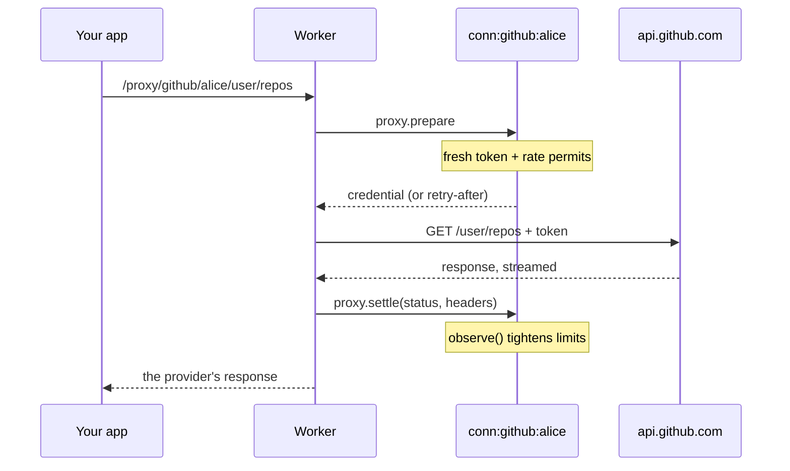
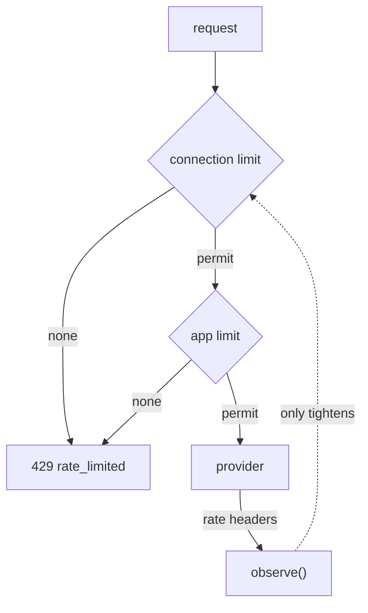

Once a connection is active, your app calls the provider **through** connectd. The token is added on the way, and your app never holds it.

```ts
const gh = oc.connection("github", userId);
const res = await gh.fetch("/user/repos?sort=updated");   // a normal Response
const repos = await res.json();

await gh.fetch("/user/starred/octocat/hello-world", { method: "PUT" });
await gh.fetch("/repos/o/r/issues", {
  method: "POST",
  headers: { "content-type": "application/json" },
  body: JSON.stringify({ title: "Hi" }),
});
```

Paths are relative to the connection's `.api({ baseUrl })`.

## What happens on each call



- At most two calls into the instance per request. **Bodies never enter the instance.** Both directions stream straight through the Worker.
- Your API key and `host` are stripped, and the connection's credential is injected the way `.api({ key })` says.
- The provider's response comes back as-is, whatever its status. A GitHub `404` is your `404`.
- connectd waits 30 seconds for the provider's response headers. A long download keeps streaming after that.

## Errors: connectd's vs the provider's

`gh.fetch` throws **only** when connectd itself refused. Those responses carry a `connectd-error` header, which the SDK turns into a `ConnectdError`:

```ts
import { ConnectdError } from "@connectd/sdk";

try {
  const res = await gh.fetch("/user");
  if (!res.ok) { /* the provider said no: inspect res.status and the body */ }
} catch (e) {
  if (e instanceof ConnectdError) {
    switch (e.code) {
      case "not_active":       // 409: e.state is "reauth_required" | "pending" | "revoked", e.reason says why
      case "rate_limited":     // 429: e.retryAfterMs; the provider was never called
      case "upstream_timeout": // 504: no response headers within 30 s
      case "upstream_error":   // 502: network failure reaching the provider
      case "not_configured":   // the connection's env names are missing
    }
  }
}
```

| Code | Status | Meaning |
| --- | --- | --- |
| `not_active` | 409 | The connection isn't active. Check `e.state` and `e.reason`. |
| `rate_limited` | 429 | No permit was free. The request never left connectd, so retrying is always safe. |
| `upstream_timeout` | 504 | The provider didn't answer in time. |
| `upstream_error` | 502 | The network failed reaching the provider. |
| `not_configured` | 503 | The connection's config (its env names) isn't set in this deployment. |
| `not_found` | 404 | Unknown definition, or the definition has no `.api()`. |
| `unauthorized` | 401 | Wrong `CONNECTD_API_KEY`. |

### Retrying rate limits

Opt in per call:

```ts
await gh.fetch("/search/code?q=foo", { retry: true });                         // up to 3 waits, 60 s total
await gh.fetch("/search/code?q=foo", { retry: { attempts: 5, maxWaitMs: 120_000 } });
```

Only connectd's own `rate_limited` is retried, which is safe for any method because the provider was never called. A streamed request body can't be sent twice: buffer it if you need retries.

## Rate limits

Define them on the connection:

```ts
.api({ baseUrl: "https://api.github.com" })
.limit({
  connection: { count: 5000, periodMs: 3_600_000 },   // each user's token: 5000/hour
  app: { count: 50, periodMs: 1_000 },                // all of github, together: 50/s
})
.observe((res, now) => rateHeaders(res, now, { remaining: "x-ratelimit-remaining", reset: "x-ratelimit-reset" }))
```



- **`connection`** limits each connection on its own. The limiter lives in that connection's instance.
- **`app`** is shared by every connection of the definition. It lives in its own instance, `app:<definition>`.
- **`observe`** turns the provider's headers into `{ remaining, resetAt, retryAfterMs }`. connectd then never sends more than the provider says is left before the reset. It **only tightens**: a header can't raise the limit above what you configured. This matters because providers count per token, and the same token may be used outside connectd.
- **Observe only.** For providers with no published limit (Google), skip `.limit()` and keep `.observe()`. The limit starts huge and follows whatever the provider reports.

The limits apply to proxied calls. Calls from `.identity()` (one per login) and from actions' `conn.api` don't take permits today.

## When you need the raw token

```ts
const cred = await gh.token();
// { kind: "oauth2", accessToken, expiresAt, … }, refreshed if it was due
```

Use this for SDKs that insist on a token, or for websockets and protocols the proxy can't carry. Prefer `fetch` or [actions](/guides/actions/) where you can: a token handed out can't be refreshed, rate-limited or revoked by connectd once it leaves.

## From inside connectd: `conn.api`

[Actions](/guides/actions/) run next to the connection and get an authenticated client with the same base URL and credential injection:

```ts
export default action({
  run: async ({ api }) => {
    const me = await api.get<{ login: string }>("/user");   // GET as JSON, throws on non-2xx
    const res = await api.fetch("/user/repos");              // a raw Response
    return { login: me.login };
  },
});
```
