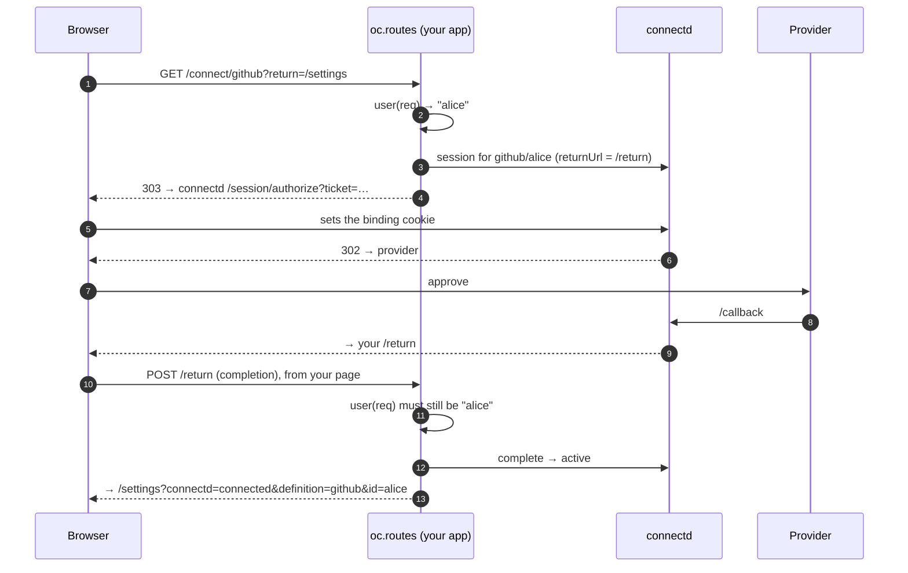

There are four ways to get a user from "not connected" to `active`. They all end in the same place. They differ in where the user is and how much UI you want to own.

| Way | Use when | You write |
| --- | --- | --- |
| [**A link through `oc.routes`**](#1-a-link-through-ocroutes) | The user is in your web app. The default. | An `<a href>` |
| [**The connect UI**](#2-the-connect-ui-in-the-browser) | You want a popup, or a button or form inside a page | `mount()` or `connect()` |
| [**A hosted link**](#3-a-hosted-link-email-chat) | The user isn't in your app (an email, a Slack message) | `link()` |
| [**From your server**](#4-from-your-server) | API keys you already have, device codes, scripts | `connect()` |

## Connection ids

A connection is `(definition, id)`. With `oc.routes`, the id is **your signed-in user's id**. For a second account of the same provider, add `?account=work`, which gives the id `<user>:work`. That's why user ids can't contain `:`.

```ts
oc.connection("github", "alice")        // alice's GitHub
oc.connection("github", "alice:work")   // alice's other GitHub account
```

## 1. A link through `oc.routes`

The simplest flow, and the one `connectd init` sets up. Mount the route once:

```ts title="app/api/connectd/[...path]/route.ts"
import { oc } from "@/lib/oc";
export const { GET, POST } = oc.routes;
```

Then link to it from any page:

```html
<a href="/api/connectd/connect/github?return=/settings">Connect GitHub</a>
<a href="/api/connectd/connect/github?account=work&return=/settings">Connect another GitHub account</a>
```



When it finishes, the user lands on `return` with `?connectd=connected&definition=github&id=alice`, or with `?connectd=error&code=access_denied`. Treat that as a hint for the UI, and call `status()` before trusting it.

For API-key definitions, the same link shows connectd's hosted form, and the key is confirmed on your page for the signed-in user.

**What `oc.routes` checks for you:**

- The connect link only works from your own pages (`Sec-Fetch-Site`), so another site can't start a connection for your user.
- The flow is bound to this browser by a cookie.
- The completion is confirmed only from your page, and only for the user who started it.
- `return` must be a path on your own origin. Anything else becomes `/`.

Your app's origin must be in `sessions.origins` in `oc.config.ts`.

## 2. The connect UI in the browser

:::note
`@kavishkagaya/connectd-connect` isn't published yet. Until it is, connect with a link to `oc.routes` (above).
:::

`@kavishkagaya/connectd-connect` is a zero-dependency browser package for a popup flow or an inline form. Your backend creates a short-lived **session token**, and the browser uses only that.

```ts title="server: an endpoint your page calls"
export async function POST(req: Request) {
  const user = await requireUser(req);
  const { token } = await oc.connection("github", user.id).session({ origin: "https://app.example.com" });
  return Response.json({ token });
}
```

**Prebuilt UI.** A button, or a form for API-key definitions:

```ts title="browser"
import { mount } from "@kavishkagaya/connectd-connect";

const unmount = mount(document.getElementById("github")!, {
  url: "https://connect.example.com",                     // your connectd URL
  token: () => fetch("/api/github-session", { method: "POST" }).then((r) => r.json()).then((r) => r.token),
  onResult: (r) => { if (r.status === "connected") location.reload(); },
});
```

The markup is unstyled, with `oc-*` classes. In React: `useEffect(() => mount(ref.current!, opts), [])`. The returned `unmount` is the cleanup.

**Headless.** Build your own UI on `connect()`:

```ts
import { connect, resume } from "@kavishkagaya/connectd-connect";

button.onclick = async () => {
  const r = await connect({ url, token: getToken, mode: "popup" });
  // r.status: "connected" | "error" (r.code) | "closed" | "redirecting"
};

// redirect mode: on the page the session's returnUrl points to
const r = await resume({ url, token });
```

- **Popup** (the default) opens a blank window first, so blockers allow it. If the popup is blocked and the session has a `returnUrl`, it falls back to a redirect.
- **Redirect** needs `session({ returnUrl })`, and the return page calls `resume()`.
- **API keys:** `connect({ url, token, fields: { key: "…" } })` submits the form with fetch, and no window opens.

## 3. A hosted link (email, chat)

For a user who isn't in your app right now:

```ts
const { url } = await oc.connection("slack", user.id).link({
  next: "https://app.example.com/settings",   // where they land once connected
  ttlMs: 15 * 60_000,
});
await sendEmail(user.email, `Connect Slack: ${url}`);
```

The link opens connectd's own page (`/connect`): a button for OAuth providers, or a form for API keys. **It works once, for whoever opens it first**, so send it only to that user and keep `ttlMs` short.

## 4. From your server

```ts
const gh = oc.connection("github", user.id);

// OAuth: a provider URL (server-side flows only, see the warning below)
const { url } = await gh.connect();

// API key you already hold: finishes inline, url is null
await oc.connection("notes", user.id).connect({ key: "sk_live_…" });

// device flow: show the code, connectd polls
const { device } = await oc.connection("acme", user.id).connect();

// client credentials / JWT bearer: no user, finishes inline
await oc.connection("internal-api", "app").connect();
await oc.connection("gcal-sa", "ops").connect({ subject: "ops@example.com" });
```

:::caution
The URL from `connect()` isn't tied to a browser. If it reaches someone else, *their* provider account can land on *your* user's connection (login CSRF). For users in a browser, use `oc.routes`, the connect UI or `link()`.
:::

## Checking and ending connections

```ts
const s = await gh.status();
// { state: "active", metadata: { id: "123", login: "alice" } }
// { state: "reauth_required", reason: "invalid_grant", metadata: … }

await gh.revoke();                 // unregister webhooks, revoke at the provider, mark revoked
await gh.revoke("user_deleted");   // with your own reason
```

`status()` on a connection that was never started throws `ConnectdError` with `code: "not_found"`. A revoked connection is final: to connect again, use a new id.

## Listing connections

```ts
for await (const c of oc.connections.list({ def: "github", state: "reauth_required" })) {
  console.log(c.id, c.reason, c.external);
}

const page = await oc.connections.page({ external: { key: "teamId", value: "T0123" }, limit: 50 });
```

The list comes from the connection index: state, reason, external ids and timestamps, never credentials.
