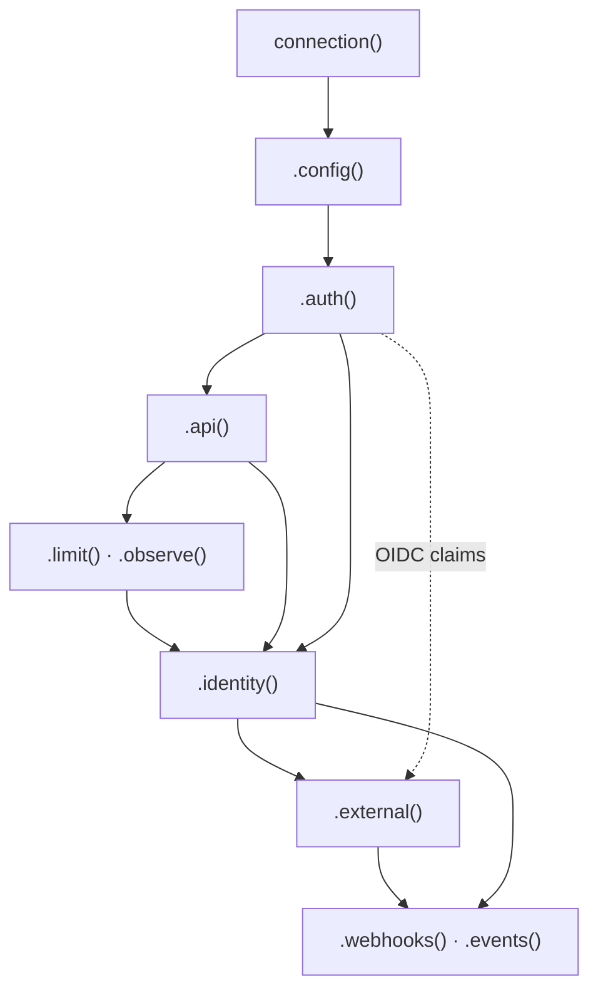

A connection file describes one provider with a typed, ordered builder:

```ts title="src/oc/github/connection.ts"
import { connection, type OAuth2Config, rateHeaders } from "@connectd/connections";

export default connection()
  .config<OAuth2Config>((env) => ({ clientId: env("GITHUB_CLIENT_ID"), clientSecret: env("GITHUB_CLIENT_SECRET") }))
  .auth((f) => f.oauth2({ authorizeUrl: "https://github.com/login/oauth/authorize", tokenUrl: "https://github.com/login/oauth/access_token" }).scopes("read:user"))
  .api({ baseUrl: "https://api.github.com", headers: { "user-agent": "my-app" } })
  .limit({ connection: { count: 5000, periodMs: 3_600_000 } })
  .observe((res, now) => rateHeaders(res, now, { remaining: "x-ratelimit-remaining", reset: "x-ratelimit-reset" }))
  .identity(async ({ api }) => {
    const u = await api.get<{ id: number; login: string }>("/user");
    return { id: String(u.id), login: u.login };
  })
  .external((me) => ({ id: me.id }));
```

## The order is enforced

Each step sees the types of the steps before it, and the types only allow this order:



`.api()` is optional, and so are `.limit()`, `.observe()`, `.identity()` and `.external()`. `.webhooks()` and `.events()` go **last**, because a later stage drops their types.

The builder is **immutable**: every call returns a new builder. A shared partial (say, `googleBase`) can be extended in several files safely. There's no `.build()`: the builder *is* the definition.

## `connection(id?)`

In a connection folder, leave the id out: the folder's name is the id. Pass one (`connection("github")`) for a connection listed in the config's `definitions` instead of a folder, or to give the typed client a literal id.

## `.config<C>(from?)`

Names the connector config type and, usually, reads it from the environment:

```ts
.config<OAuth2Config>((env) => ({
  clientId: env("GITHUB_CLIENT_ID"),          // required: missing → not_configured
  clientSecret: env("GITHUB_CLIENT_SECRET"),
}))

// optional values
.config<SlackConfig>((env) => {
  const signingSecret = env.optional("SLACK_SIGNING_SECRET");
  return { clientId: env("SLACK_CLIENT_ID"), clientSecret: env("SLACK_CLIENT_SECRET"), ...(signingSecret ? { signingSecret } : {}) };
})

// no config at all (an API key the user types in)
.config()
```

`OAuth2Config` is `{ clientId, clientSecret?, scopes? }`. Extend it for your own fields. Only the names a connection reads reach the deployed Worker.

## `.auth(f => flow)`

How a credential is made. `f` holds the flows, already typed for your config: `f.oauth2` doesn't type-check without a `clientId` in it.

```ts
.auth((f) => f.oauth2({ authorizeUrl, tokenUrl }).scopes("read:user", "repo"))
.auth((f) => f.oidc({ issuer: "https://accounts.google.com" }).scopes("email"))
.auth((f) => f.apiKey("key"))
.auth((f) => f.clientCredentials({ tokenUrl }))
```

Every flow, its options, and how to override a single step are in [auth flows](/guides/auth-flows/).

## `.api({ baseUrl, headers?, key? })`

The provider's API. It backs three things: the [proxy](/guides/calling-apis/) (`gh.fetch(path)`), `api` inside `.identity()`, and `conn.api` inside [actions](/guides/actions/).

```ts
.api({ baseUrl: "https://api.github.com", headers: { "user-agent": "my-app" } })

// where the credential goes, when it isn't `Authorization: Bearer <token>`
.api({ baseUrl: "https://notes.example.com/api", key: { header: "x-api-key" } })
.api({ baseUrl: "https://api.example.com", key: { query: "api_key" } })
.api({ baseUrl, key: { header: "authorization", prefix: "Token ", field: "token" } })
.api({ baseUrl, key: (url, headers, cred) => { /* anything else */ } })
```

`headers` are defaults: a request that sets the same header wins. For static credentials (API keys), the value is the named `field`, or the first field.

## `.limit({ connection?, app? })` and `.observe(fn)`

Rate limits for proxied calls, as `{ count, periodMs }`:

```ts
.limit({
  connection: { count: 5000, periodMs: 3_600_000 },  // per connection
  app: { count: 100, periodMs: 1_000 },              // shared by every connection of this definition
})
```

`.observe(fn)` reads the provider's own rate headers after each proxied response and **tightens** the limits to match, never loosens them. `rateHeaders(res, now, { remaining, reset })` covers the usual headers and always reads `Retry-After`. A provider with no published limit can use `.observe()` alone. See [calling APIs](/guides/calling-apis/#rate-limits).

## `.identity(fn)`

Who the credential belongs to. It runs **before** the connection becomes active, so a throw rejects the credential. That's how an API-key connection validates its key.

```ts
.identity(async ({ api, config, fetch, now }, cred) => {
  const res = await api.fetch("/me");
  if (!res.ok) throw new Error(`me ${res.status}`);  // rejected: the connection stays as it was
  const me = await res.json();
  return { id: String(me.id), email: me.email };
})
```

The result is JSON. It becomes `status().metadata`, typed in the SDK, and `conn.identity` in actions. With `.oidc()`, the id_token's claims are the identity unless you replace them.

## `.external(fn)`

The provider ids in the identity, indexed for lookup:

```ts
.external((me) => ({ id: me.id }))            // GitHub user id
.external((me) => ({ teamId: me.teamId }))    // Slack workspace
```

They power `oc.connections.list({ external: { key: "teamId", value: "T123" } })` and route app-wide webhooks (Slack's one URL per app) to every connection of that workspace.

## `.webhooks({ … })`

Incoming provider webhooks: how to verify and parse them, and optionally how to register them per connection. See [webhooks](/guides/webhooks/).

## `.events({ name: schema })`

The connection's own events, which actions send with `conn.emit()`:

```ts
import { z } from "zod";

export default connection()
  // …
  .events({ synced: z.object({ count: z.number() }) });
```

Any [Standard Schema](https://standardschema.dev) library works (zod, valibot, arktype). connectd depends on none of them. Names use letters, digits, `_` and `-`; `connection` and `webhook` are reserved. See [actions](/guides/actions/#emitting-your-own-events).

## Helpers you'll reach for

All of these come from `@connectd/connections`, so a connection file needs no other dependency:

| Helper | Use |
| --- | --- |
| `rateHeaders(res, now, names?)` | Rate headers → what `.observe()` returns |
| `hmacHex(secret, message)` | Hex HMAC-SHA256, for webhook signatures (`sha256=…`, `v0=…`) |
| `safeEqual(got, expected)` | Constant-time compare for signatures and tokens |
| `credentialFrom(tokenResponse, now)` | A token response → credential, in custom flows |
| `OAuthError` | Throw `new OAuthError("invalid_grant", …)` to say "needs re-auth" |
| `signJwt`, `signingKey`, `verifyJwt` | RS256 signing (PKCS#8 / PKCS#1) and id_token checks |
| `exchangeCode`, `refreshGrant`, `clientCredentials`, `deviceAuthorize`, … | The OAuth atoms, for custom flows |

## Trying changes

`connectd dev` reloads connection files on save, without losing state. Unit tests use `@connectd/connections/testing`, which provides a harness and a fake OAuth provider. See [testing connections](/extending/custom-providers/#testing).
