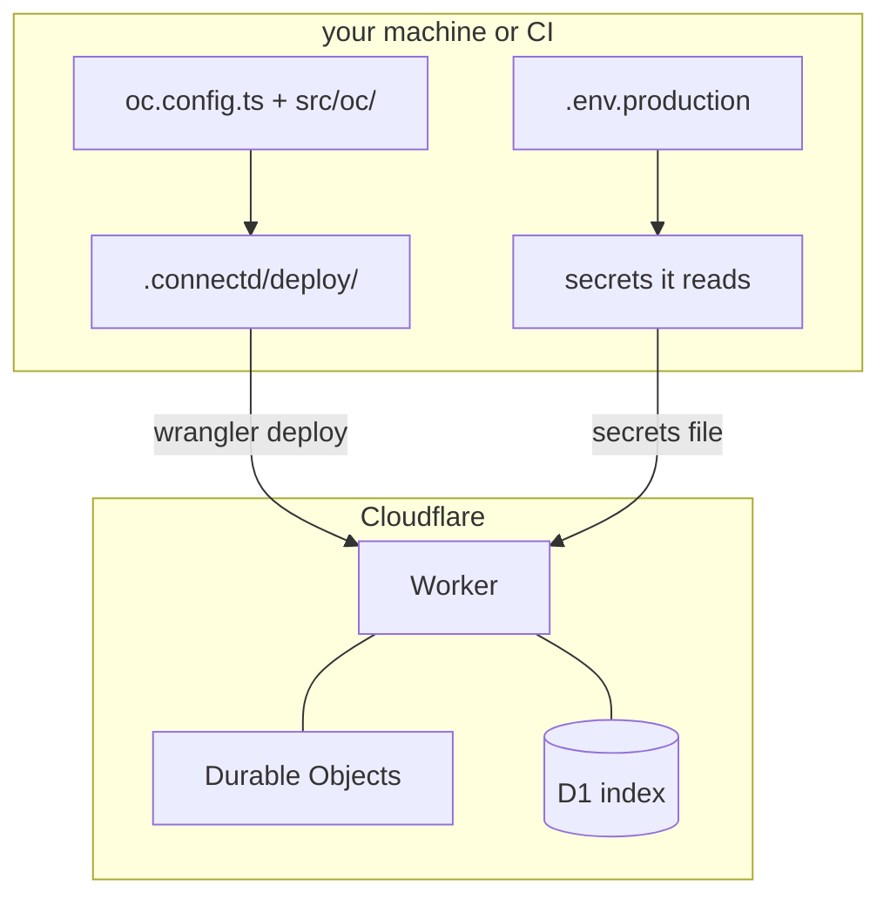
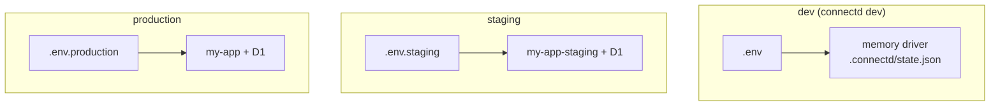

`connectd deploy` puts the runtime on **your own Cloudflare account**: one Worker in front, one Durable Object per connection, and a D1 database for the connection index. It runs through `wrangler`.



## First deploy

```sh
npm i -D wrangler
npx wrangler login                     # or set CLOUDFLARE_API_TOKEN + CLOUDFLARE_ACCOUNT_ID
cp .env .env.production                # then replace the values (see below)
npx connectd deploy
```

**`.env.production`** holds production's **provider credentials** only: usually a separate OAuth app, since the callback URL differs.

```sh title=".env.production"
APP_URL=https://app.example.com
GITHUB_CLIENT_ID=…                     # the production OAuth app
GITHUB_CLIENT_SECRET=…
```

Register the callback with the provider: `https://<your-worker>.workers.dev/callback`, or your custom domain's `/callback`.

Deploy then:

1. Resolves the project against `.env.production`, and refuses dev values (anything identical to `.env`) and generated dev keys.
2. Generates this environment's runtime keys on its first deploy. They live only in the Worker's secrets.
3. Creates the D1 database if needed and applies migrations.
4. Deploys the Worker with its secrets, through a temporary `0600` file that's removed right after.
5. Prints **your app's env** for this environment:

```text
your app's env for production:
  CONNECTD_URL=https://my-app.you.workers.dev
  CONNECTD_API_KEY=oc_…             (shown once)
  CONNECTD_EVENTS_SECRET=whsec_…    (shown once, when events are on)
```

Put those three in your app's host (Vercel, Fly, wherever your app runs).

## The target

```ts title="oc.config.ts"
import { cloudflare } from "@kavishkagaya/connectd-cloudflare";

export default defineConfig({
  target: cloudflare({
    name: "my-app",                                  // Worker name (default: the directory's)
    url: "https://connect.example.com",              // a custom domain, if not workers.dev
    environments: { staging: { url: "https://connect-staging.example.com" } },  // per --env; name defaults to my-app-staging
  }),
});
```

`--name` and `--url` override these per run.

## Environments

Each environment is a **whole deployment of its own**, with its own Worker, database, keys and env file. Staging can never read production's connections.

```sh
npx connectd deploy                  # production: .env.production → Worker my-app, D1 my-app-index
npx connectd deploy --env staging    # staging:    .env.staging    → Worker my-app-staging, D1 my-app-staging-index
```



`development`, `dev` and `local` are dev's names and refused as deploy environments.

## Deploying from CI

In CI (`CI=true`), deploy reads the **shell environment** (your CI secrets), not a file. It **never generates or prints** the API key or events secret there. Make them once:

```sh
npx connectd keys   # prints a fresh CONNECTD_API_KEY and CONNECTD_EVENTS_SECRET
```

Store them in your CI secrets *and* in your app's host:

```yaml title=".github/workflows/connectd.yml"
name: connectd
on:
  push:
    branches: [main]
jobs:
  deploy:
    runs-on: ubuntu-latest
    steps:
      - uses: actions/checkout@v4
      - uses: actions/setup-node@v4
        with: { node-version: 22 }
      - run: npm ci
      - run: npx connectd deploy --url ${{ vars.CONNECTD_URL }}
        env:
          CLOUDFLARE_API_TOKEN: ${{ secrets.CLOUDFLARE_API_TOKEN }}
          CLOUDFLARE_ACCOUNT_ID: ${{ secrets.CLOUDFLARE_ACCOUNT_ID }}
          CONNECTD_API_KEY: ${{ secrets.CONNECTD_API_KEY }}
          CONNECTD_EVENTS_SECRET: ${{ secrets.CONNECTD_EVENTS_SECRET }}
          GITHUB_CLIENT_ID: ${{ secrets.OAUTH_GITHUB_CLIENT_ID }}
          GITHUB_CLIENT_SECRET: ${{ secrets.OAUTH_GITHUB_CLIENT_SECRET }}
```

- `--url` (or `cloudflare({ url })`) is needed because CI doesn't have `.connectd/deploy/state.json` from an earlier deploy.
- GitHub secret names can't start with `GITHUB_`, hence the `OAUTH_` prefix. The env names your connection reads stay `GITHUB_CLIENT_ID`.
- Runtime keys (encryption, state, sessions, webhooks) stay in the Worker from the first deploy. CI doesn't need them.

## Rotating keys

```sh
npx connectd deploy --rotate key            # adds CONNECTD_KEY_V<n+1>; old credentials re-seal on read
npx connectd deploy --rotate api-key        # new CONNECTD_API_KEY (update your app)
npx connectd deploy --rotate events         # new CONNECTD_EVENTS_SECRET (update your app)
npx connectd deploy --rotate state,sessions # new signing keys (in-flight logins must restart)
```

## Without deploying: the plan

```sh
npx connectd deploy --dry-run
npx wrangler deploy --dry-run -c .connectd/deploy/wrangler.json   # bundles it offline
```

`--dry-run` writes `.connectd/deploy/` (the Worker entry, `wrangler.json` and migrations) and prints what it would do, without calling Cloudflare.

## Other hosts

The Cloudflare target is the one built in. The runtime itself only needs a [driver](/concepts/architecture/#l0--drivers-infrastructure-only): see [self-hosting without the CLI](/extending/self-hosting/) and [targets](/extending/extensions/#deploy-targets).
