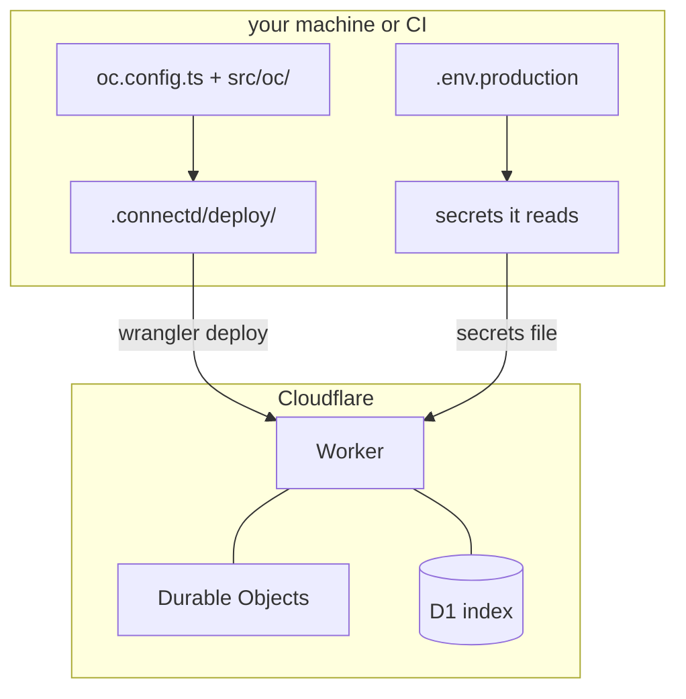
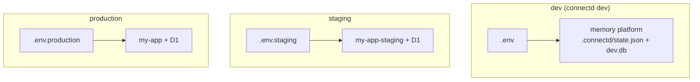

`connectd deploy` puts the runtime on **your own Cloudflare account**: one Worker in front, one Durable Object per connection, and a D1 database for the connection index. It runs through `wrangler`.



## First deploy

```sh
cp .env .env.production                # then replace the values (see below)
npx connectd deploy
```

Deploy checks wrangler first. `connectd init` installed it in your project when you picked Cloudflare; if it's missing, deploy offers to install it (a dev dependency, with your package manager). If wrangler isn't logged in to Cloudflare, deploy offers `wrangler login`, which opens your browser. In CI there's nobody to ask, so it stops before any step and says what to set: `CLOUDFLARE_API_TOKEN` (Workers Scripts and D1: edit) and `CLOUDFLARE_ACCOUNT_ID`.

**`.env.production`** holds production's **provider credentials** only: usually a separate OAuth app, since the callback URL differs.

```sh title=".env.production"
APP_URL=https://app.example.com
GITHUB_CLIENT_ID=…                     # the production OAuth app
GITHUB_CLIENT_SECRET=…
```

Register the callback with the provider: `https://<your-worker>.workers.dev/callback`, or your custom domain's `/callback`.

Deploy then:

1. Resolves the project against `.env.production`, and refuses dev values (anything identical to `.env`).
2. Derives this environment's runtime keys from the project's root key (`CONNECTD_ROOT_KEY`, which `connectd init` put in `.env`). The same values on every deploy, from any machine; the root key itself is never sent. Only keys the deployment doesn't have yet are set: a redeploy never replaces a key it holds, so what it stored stays readable.
3. Creates the D1 database if needed and applies migrations.
4. Deploys the Worker with its secrets, through a temporary `0600` file that's removed right after.
5. On the first deploy, makes your app's API key (and events secret, when events are on) in the deployment's database, and prints **your app's env** for this environment:

```text
your app's env for production:
  CONNECTD_URL=https://my-app.you.workers.dev
  CONNECTD_API_KEY=ock_…            (new: shown once. `connectd keys` rolls or revokes it)
  CONNECTD_EVENTS_SECRET=whsec_…    (new: shown once)

dashboard: `connectd dashboard --env production` opens it signed in
```

Put those three in your app's host (Vercel, Fly, wherever your app runs). Later deploys leave the keys as they are; another service gets its own with `connectd keys create worker --env production`.

## The target

```ts title="oc.config.ts"
import { cloudflare } from "@kavishkagaya/connectd-cloudflare";

export default defineConfig({
  target: cloudflare({
    name: "my-app",                                  // Worker name (default: the directory's)
    url: "https://connect.example.com",              // a custom domain, if not workers.dev
    environments: { staging: { url: "https://connect-staging.example.com" } },  // per --env; name defaults to my-app-staging
  }),
});
```

`--name` and `--url` override these per run.

## Environments

Each environment is a **whole deployment of its own**, with its own Worker, database, keys and env file. Staging can never read production's connections.

```sh
npx connectd deploy                  # production: .env.production → Worker my-app, D1 my-app-index
npx connectd deploy --env staging    # staging:    .env.staging    → Worker my-app-staging, D1 my-app-staging-index
```



`development`, `dev` and `local` are dev's names and refused as deploy environments.

## Deploying from CI

In CI (`CI=true`), deploy reads the **shell environment** (your CI secrets), not a file. The project's root key is one of them. Deploy once by hand first (it prints your app's keys), or make them later with `connectd keys create app --env production`.

```yaml title=".github/workflows/connectd.yml"
name: connectd
on:
  push:
    branches: [main]
jobs:
  deploy:
    runs-on: ubuntu-latest
    steps:
      - uses: actions/checkout@v4
      - uses: actions/setup-node@v4
        with: { node-version: 22 }
      - run: npm ci
      - run: npx connectd deploy --url ${{ vars.CONNECTD_URL }}
        env:
          CLOUDFLARE_API_TOKEN: ${{ secrets.CLOUDFLARE_API_TOKEN }}
          CLOUDFLARE_ACCOUNT_ID: ${{ secrets.CLOUDFLARE_ACCOUNT_ID }}
          CONNECTD_ROOT_KEY: ${{ secrets.CONNECTD_ROOT_KEY }}
          GITHUB_CLIENT_ID: ${{ secrets.OAUTH_GITHUB_CLIENT_ID }}
          GITHUB_CLIENT_SECRET: ${{ secrets.OAUTH_GITHUB_CLIENT_SECRET }}
```

- `--url` (or `cloudflare({ url })`) is needed because CI doesn't have `.connectd/deploy/state.json` from an earlier deploy.
- GitHub secret names can't start with `GITHUB_`, hence the `OAUTH_` prefix. The env names your connection reads stay `GITHUB_CLIENT_ID`.
- `CONNECTD_ROOT_KEY` is the only connectd secret CI needs: the runtime's keys derive from it.

## Keys and the dashboard

Your app's keys live in the deployment's database. Manage them from the CLI or the dashboard, with no redeploy:

```sh
npx connectd keys --env production                         # list
npx connectd keys create worker --env production           # another service's key, shown once
npx connectd keys roll app --env production --grace 24h    # a new secret; the old one works for a day
npx connectd keys revoke worker --env production
npx connectd dashboard --env production                    # the dashboard, signed in
```

The dashboard's first sign-in is that CLI link; it then asks you to make an account (a passkey or a password), so you can sign in from anywhere afterwards and invite teammates. With `--url` and `CONNECTD_ROOT_KEY` in the shell, these commands work outside the project too.

The runtime's own keys only rotate for encryption:

```sh
npx connectd deploy --rotate key            # adds CONNECTD_KEY_V<n+1>; old credentials re-seal on read
```

## Without deploying: the plan

```sh
npx connectd deploy --dry-run
npx wrangler deploy --dry-run -c .connectd/deploy/wrangler.json   # bundles it offline
```

`--dry-run` writes `.connectd/deploy/` (the Worker entry, `wrangler.json` and migrations) and prints what it would do, without calling Cloudflare.

## Other hosts

The Cloudflare target is the one built in. The runtime itself only needs a [platform](/concepts/architecture/#l0--platform-infrastructure-only): see [self-hosting without the CLI](/extending/self-hosting/) and [targets](/extending/extensions/#deploy-targets).
