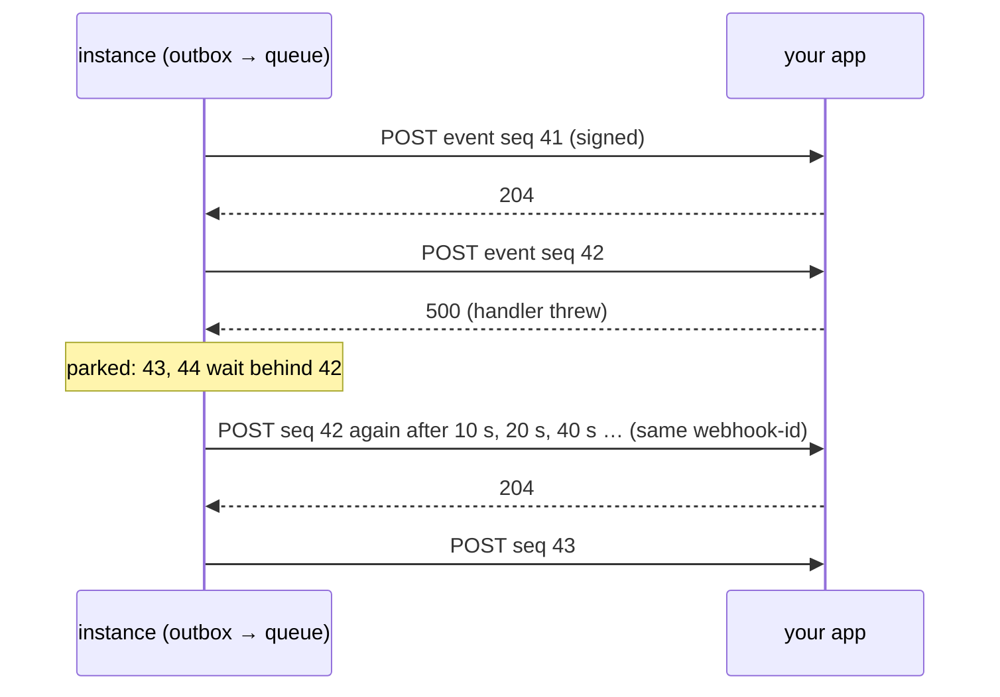

connectd POSTs **events** to your app whenever something happens to a connection: it became active, it needs a new login, a webhook arrived, an action finished.

```ts title="src/oc/github/events.ts"
import { listen } from "@connectd/sdk";

export default listen("github")
  .on("connection.active", async (e, conn) => {
    await db.users.update(e.connection.id, { githubConnected: true });
  })
  .on("connection.reauth_required", (e) => notify(e.connection.id, "Reconnect GitHub"))
  .on("webhook.push", (e) => enqueueBuild(e.data.payload))
  .on("syncIssues.completed", (e) => console.log(e.data.output))
  .on("*", (e) => console.log(e.type));
```

## Turning it on

Point `events.url` at your app's route, and give your app the secret:

```ts title="oc.config.ts"
export default defineConfig((env) => ({
  events: { url: `${env.APP_URL}/api/connectd/events` },
  // …
}));
```

`oc.routes` handles `POST …/events`. It verifies the signature with `CONNECTD_EVENTS_SECRET` and dispatches each event to the folder's `listen()` handlers, collected into `.connectd/app.ts`:

```ts title="src/lib/oc.ts"
import { listeners } from "../../.connectd/app";
export const oc = connectd({ user, listeners });
```

## Event types

| Type | When | `data` |
| --- | --- | --- |
| `connection.<state>` | Every [state change](/concepts/lifecycle/): `connection.active`, `connection.reauth_required`, `connection.revoked`, `connection.pending` | `{ from, to, reason? }` |
| `webhook.<topic>` | A provider webhook routed to this connection: `webhook.push`, `webhook.message` | `{ topic, delivery, payload, truncated? }` |
| `<action>.completed` | A scheduled or `on` action succeeded | `{ action, trigger, output }` |
| `<action>.failed` | A scheduled or `on` action threw | `{ action, trigger, error, attempt }` |
| `<name>` | One of the connection's own events, sent with `conn.emit` | The schema's output |

Every event has the same envelope:

```json
{
  "id": "conn:github:alice:42",
  "seq": 42,
  "type": "connection.active",
  "at": 1761400000000,
  "connection": { "definition": "github", "id": "alice" },
  "data": { "from": "pending", "to": "active" }
}
```

Types come from your project's registry. `on("connection.actve", …)` is a type error, and `e.data` is typed per event.

## Delivery guarantees



- **Nothing is lost.** A state change and its event are written in the same atomic write (a transactional outbox), then moved to a delivery queue exactly once.
- **In order, per connection.** Events for one connection arrive in `seq` order. If one fails, the ones behind it wait. Different connections never block each other.
- **At least once.** Delivery is retried until your app answers 2xx, with backoff from 10 s up to 1 hour. The `id` (also the `webhook-id` header) is the same on every retry, so **dedupe on it**.
- **Bounded.** Up to 1000 pending events per connection. Past that, the oldest are dropped and marked as dropped. The 20 most recent done events are kept for the dashboard and for redelivery.
- **Non-blocking.** Events are POSTed from the queue's own timer, so a slow endpoint never holds up the call that caused the event. Each POST times out after 10 s, and redirects aren't followed.

**Your answer is the contract:**

| Your response | connectd does |
| --- | --- |
| `2xx` | Done, so it sends the next one |
| Anything else, timeout, network error | Keeps the event and retries it, in order |

The SDK answers `204` when every handler succeeded (or there was nothing to do), `401` for a bad signature, and `500` if a handler threw.

## Without the folder convention: `oc.events()`

Mount a handler yourself, in any framework that speaks `Request → Response`:

```ts
const ev = oc.events({
  secret: process.env.CONNECTD_EVENTS_SECRET!,
  dedupe: redisSet,            // optional: { has(id), add(id) }, with a TTL in production
});

ev.on("connection.reauth_required", async (e, conn) => {
  const s = await conn.status();       // conn is a client for e.connection
  await notify(e.connection.id);
});

export const POST = (req: Request) => ev.handle(req);   // Next, Hono (c.req.raw), Bun, Workers, Deno
```

For Express or Node's `http`, wrap it with `toNode` from `@connectd/sdk/node`:

```ts
import { toNode } from "@connectd/sdk/node";
app.post("/connectd/events", toNode((req) => ev.handle(req)));   // before express.json(), or after express.raw()
```

Pass the request untouched: the signature covers the raw body.

## Verifying without the SDK

Events follow [Standard Webhooks](https://www.standardwebhooks.com), so any of its libraries works:

```text
webhook-id:        conn:github:alice:42
webhook-timestamp: 1761400000
webhook-signature: v1,<base64 HMAC-SHA256(secret, "<id>.<timestamp>.<body>")>
```

The secret is `whsec_` plus base64 key bytes. `@connectd/runtime/signature` exports `sign` and `verify` with no other imports.

## Operating the queue

Every connection exposes its queue through methods:

```ts
await gh.call("events.status");                  // pending, attempt, retryAt, last error, recent events
await gh.call("events.flush");                   // try the head now, instead of waiting for the backoff
await gh.call("events.redeliver", { slot: 17 }); // send a delivered event again (as a copy)
```

The dashboard shows the same queue per connection, and failures across all connections.
