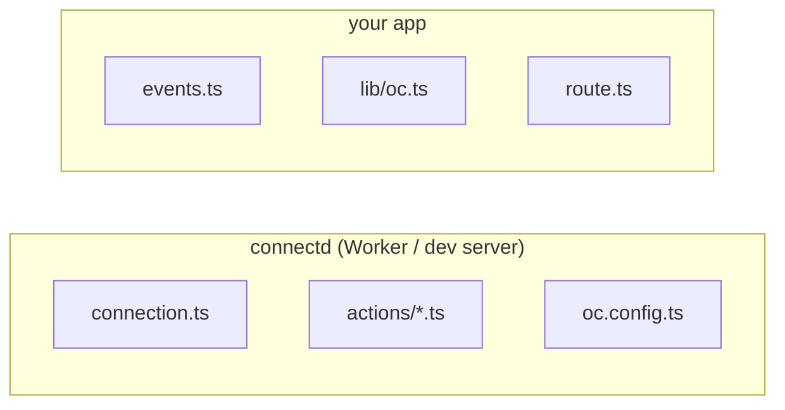

A connectd project lives inside your app's repository. Most of it is one folder per connection.

```text
my-app/
├── oc.config.ts                  the project
├── .env                          keys + provider credentials (gitignored)
├── .env.production               production's provider credentials (gitignored)
├── src/
│   ├── oc/                       connection folders (the config's `dir`)
│   │   ├── github/
│   │   │   ├── connection.ts     the connection (default export) — runs in connectd
│   │   │   ├── actions/
│   │   │   │   ├── profile.ts    one action per file — runs in connectd
│   │   │   │   └── syncIssues.ts
│   │   │   └── events.ts         your handlers — runs in your app
│   │   └── slack/
│   │       └── connection.ts
│   ├── lib/oc.ts                 the SDK client
│   └── app/api/connectd/[...path]/route.ts   oc.routes
└── .connectd/                    generated, self-gitignoring
    ├── app.ts                    every folder's events.ts, for connectd({ listeners })
    ├── registry.d.ts             types: which connections, actions, events exist
    ├── entry.ts                  config + folders: what dev and deploy run
    ├── state.json                connectd dev's saved state
    └── deploy/                   the generated Worker, wrangler.json, migrations
```

## Which code runs where



`connection.ts`, `actions/` and `oc.config.ts` are bundled into connectd. `events.ts` is **never** part of connectd. It runs in your app through `.connectd/app.ts`, so it can import your database and your code.

## oc.config.ts

```ts title="oc.config.ts"
import { defineConfig } from "@kavishkagaya/connectd";
import { cloudflare } from "@kavishkagaya/connectd-cloudflare";

export default defineConfig((env) => ({
  dir: "src/oc",                                         // default: src/oc, else oc
  target: cloudflare({ name: "my-app" }),                // where `connectd deploy` goes
  events: { url: `${env.APP_URL}/api/connectd/events` }, // where events are POSTed
  sessions: { origins: [env.APP_URL as string] },        // origins allowed to run the connect UI
}));
```

The config can be an object, or a function of the environment. With a function, read env names one at a time (`env.APP_URL`). connectd tracks which names you read, and only those (plus `CONNECTD_*`) are sent to the deployed Worker. Spreading or listing `env` throws, on purpose.

Every option is described in the [config reference](/reference/config/).

## Connection folders

- The **folder name is the connection id**: letters, digits, `_` and `-`, up to 64 characters. It appears in URLs and in `oc.connection("<id>", …)`.
- `connection.ts` must `export default` a `connection()` builder.
- `actions/<name>.ts` must `export default` an `action({ … })`. The file name is the action's name.
- `events.ts` should `export default listen("<id>")…`.
- Test files (`*.test.ts`, `*.spec.ts`) and `.d.ts` files are skipped.

## .env

One file, shared by your app and connectd in dev:

```sh title=".env"
APP_URL=http://localhost:3000
CONNECTD_URL=http://localhost:8787

# provider credentials, read by each connection's .config((env) => …)
GITHUB_CLIENT_ID=…
GITHUB_CLIENT_SECRET=…

# connectd's dev keys (connectd init)
CONNECTD_API_KEY=oc_…
CONNECTD_EVENTS_SECRET=whsec_…
CONNECTD_KEY_V1=…
CONNECTD_STATE_KEY=…
CONNECTD_SESSIONS_KEY=…
CONNECTD_WEBHOOKS_KEY=…
```

A connection whose required env names are missing still loads, but answers `not_configured` and lists the names it needs. `connectd dev` prints them at startup.

Deployed environments read `.env.<name>` (`.env.production`, `.env.staging`). See [deploying](/guides/deploying/).

## .connectd/

Generated by `connectd dev`, `connectd deploy` and `connectd types`. Never edit it. It ignores itself in git.

- `registry.d.ts` is what makes `oc.connection("github", id)` typed: the known ids, each connection's identity, actions and events.
- `app.ts` collects the listeners. Import it in `lib/oc.ts`.
- In CI, run `connectd types` before building your app, so these exist.
