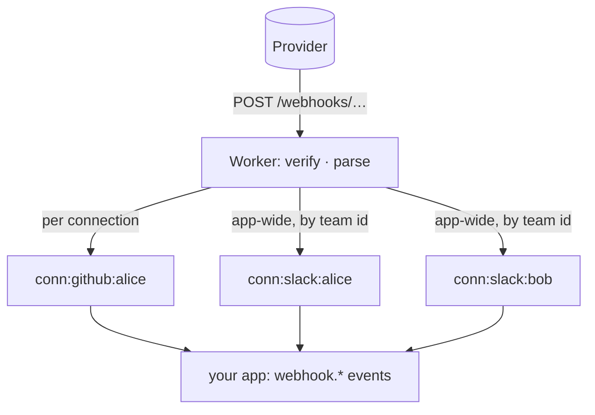
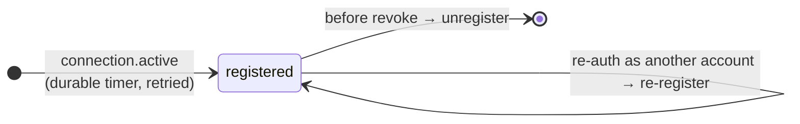

Providers push changes by webhook. connectd receives them, checks the provider's signature, finds the connection they belong to, and delivers them to your app as `webhook.<topic>` [events](/guides/events/), in order and retried.



Your app handles them like any event:

```ts
listen("github").on("webhook.push", (e) => {
  e.data.topic;     // "push"
  e.data.delivery;  // the provider's delivery id: dedupe on it
  e.data.payload;   // the JSON body (null over 1 MB, with `truncated` = size)
});
```

## Two shapes of webhook

| | Per connection | App-wide |
| --- | --- | --- |
| URL | `/webhooks/:def/:id` | `/webhooks/:def` |
| Example | GitHub repo hooks, Google watch channels | Slack Events API, GitHub App webhooks |
| Secret | Derived for this connection alone, handed to the provider at registration | The app's (Slack signing secret), from config |
| Routing | The URL names the connection | `parse()` returns an `external` id, and every connection with it gets the event |
| Registration | connectd creates it per connection | You set one URL in the provider's settings |

App-wide routing uses the connection index: Slack's `team_id` matches the `teamId` that `.external()` indexed.

## Defining webhooks

Add `.webhooks()` as the last step of the connection:

```ts
.webhooks({
  // Is it really from the provider? `secret` is this connection's own on /webhooks/:def/:id, null on the app-wide route.
  async verify(ctx, req, secret) {
    return secret !== null && safeEqual(req.headers.get("x-hub-signature-256") ?? "", `sha256=${await hmacHex(secret, req.body)}`);
  },

  // Turn a verified request into an event, or a handshake reply.
  parse(req) {
    const topic = req.headers.get("x-github-event") ?? "";
    if (topic === "ping") return { reply: null };               // answered as is, not delivered
    return {
      topic,
      payload: JSON.parse(req.body),
      delivery: req.headers.get("x-github-delivery") ?? undefined,
      // app-wide only: external: { key: "teamId", value: body.team_id },
    };
  },

  topics: ["push", "pull_request"],   // optional: only these are delivered (and typed); others are acknowledged and dropped
})
```

`req.body` is the **raw** string. Verify first, then parse. A `parse` that throws answers `400`.

## Registering per connection

Add `register` (and `unregister`) and connectd manages the provider-side subscription for you.

**Automatic: one per connection.** Without a `subscription` schema, `register` runs on its own when a connection goes active:

```ts
async register(ctx, cred, { url, secret }) {
  const res = await ctx.fetch("https://api.provider.com/webhooks", {
    method: "POST",
    headers: { authorization: `Bearer ${cred.kind === "oauth2" ? cred.accessToken : ""}` },
    body: JSON.stringify({ url, secret }),
  });
  const hook = await res.json();
  return { hook: { id: hook.id }, expiresAt: hook.expires_at };   // what unregister needs; when it lapses
},
async unregister(ctx, cred, hook) {
  await ctx.fetch(`https://api.provider.com/webhooks/${(hook as { id: string }).id}`, { method: "DELETE" });
},
```



- Registration runs on a durable timer with retries, so a provider outage doesn't lose it.
- With `expiresAt` (Google channels), it's renewed an hour before it lapses, or at half-life for short ones.
- After a re-auth to a *different* account, it's registered again for the new one.
- `unregister` runs before revoke, while the credential still works. It's best effort.
- `hook` is stored unsealed and shown in the dashboard, so put **ids only** in it, never secrets.

**Explicit: any number, made by your app.** With a `subscription` schema, your app creates subscriptions, and `register` gets the input:

```ts
.webhooks({
  verify, parse,
  subscription: repoHook,   // a Standard Schema for { repo: "owner/name", events?: string[] }
  async register(ctx, cred, { url, secret }, { repo, events = ["push"] }) {
    const res = await ctx.fetch(`https://api.github.com/repos/${repo}/hooks`, {
      method: "POST",
      headers: { authorization: `Bearer ${cred.kind === "oauth2" ? cred.accessToken : ""}`, "content-type": "application/json" },
      body: JSON.stringify({ name: "web", active: true, events, config: { url, secret, content_type: "json" } }),
    });
    if (!res.ok) throw new Error(`create hook on ${repo}: ${res.status}`);
    return { hook: { repo, id: (await res.json()).id } };
  },
  async unregister(ctx, cred, hook) { /* DELETE /repos/{repo}/hooks/{id} */ },
})
```

```ts title="your app"
const gh = oc.connection("github", userId);
const sub = await gh.webhooks.subscribe({ repo: "acme/api", events: ["push", "pull_request"] });  // typed from the schema
await gh.webhooks.list();
await gh.webhooks.unsubscribe(sub.id);
```

Explicit subscriptions are renewed and moved to a new account the same way, and all of them are removed before revoke.

## Setup checklist

- The runtime needs a public URL for providers to reach. Deployed, that's automatic. In dev, run `connectd dev --tunnel` (a Cloudflare quick tunnel) or `--url https://your-tunnel`. Slack needs https.
- `events.url` must be set in `oc.config.ts`. Without somewhere to deliver, webhooks are refused with `503`, so the provider retries instead of losing them.
- For app-wide webhooks, put the URL (`https://<connectd>/webhooks/slack`) in the provider's app settings, and the signing secret in `.env`.
- `gh.call("webhooks.status")` shows the connection's ingress URL, registration and pending state. `gh.call("webhooks.endpoint")` returns `{ url, secret }`, for creating hooks yourself through the proxy (GitHub org hooks).

## Delivery semantics

- A webhook for one connection that the instance can't take answers `5xx`, so the provider retries.
- With app-wide fan-out, if any connection fails to take it, the whole request answers `503` and the provider retries. Connections that already took it get it twice, so dedupe on `e.data.delivery`.
- Revoked connections are skipped. Topics outside `topics` are acknowledged with `200` and dropped.
- Payloads over 1 MB are delivered with `payload: null` and `truncated: <bytes>`. Fetch the object from the provider through the proxy instead.
