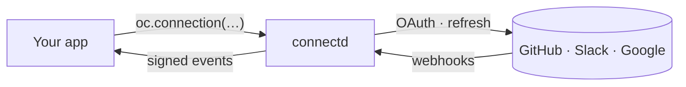

import { Card, CardGrid, LinkCard } from "@astrojs/starlight/components";

export const at = (path) => import.meta.env.BASE_URL.replace(/\/$/, "") + path;

## How it works

You write one small file per provider. connectd runs each connection as its own small server, holding its token, timers and event queue. Your app names a connection and asks it to do things.

## What you get

<CardGrid>
  <Card title="Tokens never touch your app" icon="seti:lock">
    Credentials are encrypted inside connectd. Your app calls the provider through a proxy that adds the token, or runs an action next to it.
  </Card>
  <Card title="Refresh and re-auth, handled" icon="random">
    Tokens refresh before they expire, failures retry with backoff, and a connection that needs a new login tells your app with an event.
  </Card>
  <Card title="Webhooks in, events out" icon="rocket">
    Provider webhooks are verified and routed to the right connection. Your app gets signed, ordered, retried events, using the Standard Webhooks format.
  </Card>
  <Card title="One file per provider" icon="pencil">
    A typed builder: `connection().config().auth().api().identity()`. Copy one from the catalog with `connectd add`, or write your own.
  </Card>
  <Card title="Runs where you run" icon="cloud-download">
    `connectd dev` runs in memory on your laptop. `connectd deploy` puts it on your own Cloudflare account, with one Durable Object per connection.
  </Card>
  <Card title="Open source" icon="open-book">
    Apache-2.0. The whole runtime is in the repo, so you can read it, fork it, or self-host it without the CLI.
  </Card>
</CardGrid>

## Start here

<CardGrid>
  <LinkCard title="Quickstart" description="Connect GitHub in a Next.js app, running locally, in about ten minutes." href={at("/start/quickstart/")} />
  <LinkCard title="The mental model" description="Connections, instances and the three directions of traffic." href={at("/concepts/mental-model/")} />
  <LinkCard title="Defining connections" description="The connection() builder, step by step." href={at("/guides/defining-connections/")} />
  <LinkCard title="Contributing" description="How the repo is laid out, and how to add a provider." href={at("/contributing/overview/")} />
</CardGrid>
