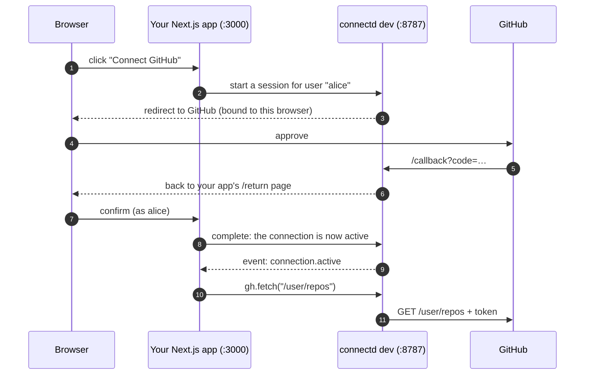

In about ten minutes: your users click **Connect GitHub**, approve, and your app lists their repositories through connectd. Nothing GitHub-specific is stored in your app.

## What you'll build



## 1. Prerequisites

- Node.js 22 or later (or Bun 1.3+)
- A Next.js app using the App Router. Any framework with `Request → Response` handlers works the same way; Next.js just gets its files generated for you.
- A GitHub account

## 2. Install

```sh
npm i @connectd/sdk @connectd/connections @connectd/cli @connectd/cloudflare @connectd/runtime @connectd/kernel
```

| Package | What it's for |
| --- | --- |
| `@connectd/sdk` | The client your app uses: `connectd()`, `oc.routes`, `listen()` |
| `@connectd/connections` | What connection files import: `connection()`, `action()` |
| `@connectd/cli` | The `connectd` command: `init`, `add`, `dev`, `deploy` |
| `@connectd/cloudflare` | The deploy target for `connectd deploy` |
| `@connectd/runtime`, `@connectd/kernel` | The runtime that `dev` and `deploy` run |

## 3. Set up the project

```sh
npx connectd init
```

`init` writes only what's missing and never overwrites:

```text
.env                                    keys for dev, CONNECTD_URL, APP_URL
.gitignore                              adds .env (it holds keys now)
oc.config.ts                            the project config
src/lib/oc.ts                           the client
src/app/api/connectd/[...path]/route.ts one route: connect, return, events
```

`.env` is shared: your app reads `CONNECTD_URL`, `CONNECTD_API_KEY` and `CONNECTD_EVENTS_SECRET` from it, and `connectd dev` reads the rest.

## 4. Add GitHub

```sh
npx connectd add github
```

This copies the GitHub provider into `src/oc/github/connection.ts`, adds an empty `src/oc/github/events.ts`, and appends `GITHUB_CLIENT_ID=` and `GITHUB_CLIENT_SECRET=` to `.env`. The file is now yours to read and change. See [providers are code](/concepts/providers-as-code/).

Create a GitHub OAuth app at **github.com/settings/developers → OAuth Apps → New OAuth App**:

- **Homepage URL:** `http://localhost:3000`
- **Authorization callback URL:** `http://localhost:8787/callback`

Put its client ID and a new client secret in `.env`:

```sh title=".env"
GITHUB_CLIENT_ID=Ov23li…
GITHUB_CLIENT_SECRET=…
```

:::tip
The callback goes to **connectd** (port 8787), not to your app. connectd does the code exchange, then sends the user back to your app.
:::

## 5. Tell connectd who is signed in

Open `src/lib/oc.ts` and return your signed-in user's id. That id becomes the connection id, so every user gets their own GitHub connection:

```ts title="src/lib/oc.ts"
import { connectd } from "@connectd/sdk";
import { listeners } from "../../.connectd/app";

export const oc = connectd({
  user: async (req) => (await getSession(req))?.userId ?? null, // your auth here
  listeners,
});
```

The generated route needs no changes:

```ts title="src/app/api/connectd/[...path]/route.ts"
import { oc } from "@/lib/oc";
export const { GET, POST } = oc.routes;
```

## 6. Use the connection

```tsx title="src/app/page.tsx"
import { oc } from "@/lib/oc";

export default async function Page() {
  const user = await currentUserId(); // your auth here
  const gh = oc.connection("github", user);
  const status = await gh.status().catch(() => null);

  if (status?.state !== "active")
    return <a href="/api/connectd/connect/github?return=/">Connect GitHub</a>;

  const repos = await (await gh.fetch("/user/repos?sort=updated")).json();
  return (
    <ul>
      {repos.map((r: { full_name: string }) => <li key={r.full_name}>{r.full_name}</li>)}
    </ul>
  );
}
```

`gh.fetch` goes through connectd's proxy, which adds the token, refreshes it if it's due, and applies GitHub's rate limits. Your app never sees the token.

## 7. React to events

```ts title="src/oc/github/events.ts"
import { listen } from "@connectd/sdk";

export default listen("github")
  .on("connection.active", (e) => console.log(`github connected for ${e.connection.id}`))
  .on("connection.reauth_required", (e) => console.log(`github needs a new login for ${e.connection.id}`));
```

These handlers run in your app. They get there through the route from step 5, signed and verified.

## 8. Run it

In two terminals:

```sh
npx connectd dev      # the runtime on :8787
```

```sh
npx next dev          # your app on :3000
```

Open http://localhost:3000, sign in, and click **Connect GitHub**.

`connectd dev` runs the whole runtime in memory with a real clock. It keeps state in `.connectd/state.json`, so connections survive restarts, and it reloads when you save a connection file. The dashboard is at http://localhost:8787/dashboard. Sign in with `CONNECTD_API_KEY` from `.env`.

## A complete example

[`examples/nextjs`](https://github.com/Kavishkagaya/connectd/tree/main/examples/nextjs) in the repository is this quickstart, finished: demo sign-in, status, disconnect, and the repository list.

## Next steps

- [The mental model](/concepts/mental-model/): what a connection is, and why it works this way.
- [Defining connections](/guides/defining-connections/): read and change `connection.ts`.
- [Deploying](/guides/deploying/): `npx connectd deploy` to your Cloudflare account.
