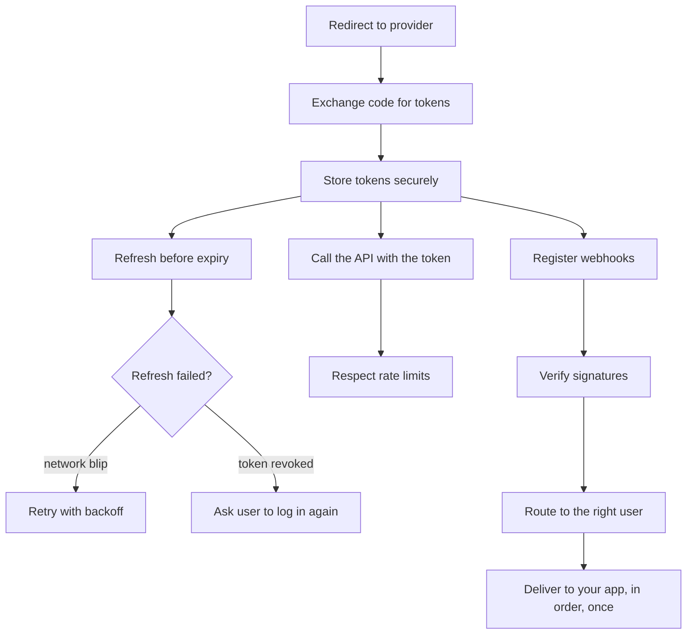

Adding an integration starts out looking like one redirect and one token exchange. Then the rest of the work shows up.

## What "connect GitHub" actually involves

Each box is small. Together they make a distributed system:

- **Races.** Two requests find the token expired and both refresh it. The provider rotates refresh tokens, so the slower one gets `invalid_grant` and the user is logged out for no reason.
- **Secrets at rest.** Tokens sit in your database next to user data. Rotating the encryption key means migrating every row.
- **Provider quirks.** GitHub returns errors with a `200`. Slack nests the user token under `authed_user`. Google needs `access_type=offline` to give a refresh token at all. Every provider has a list like this.
- **Webhooks.** Each provider signs them differently, some send one URL per app (Slack), some one per repo (GitHub), and some expire them (Google channels).
- **Delivery to your app.** "Tell my app the user disconnected" needs ordering, retries, deduplication and a record of what was sent.
- **Login CSRF.** A connect link that isn't tied to the browser that opened it lets someone attach *their* provider account to *your* user.

## What connectd does

connectd is the part of your backend that owns connections. You describe each provider once. connectd runs that description, one isolated instance per connection, and handles every box above.

| You write | connectd handles |
| --- | --- |
| A [connection file](/guides/defining-connections/) per provider: endpoints, scopes, quirks | The OAuth dance, PKCE, `state`, the callback |
| Nothing | Encrypting credentials, key rotation, refresh before expiry, single-flight refresh, retry and backoff, `reauth_required` |
| `gh.fetch("/user/repos")` | Adding the token, rate limits, reading the provider's rate headers |
| A `listen("github").on("connection.active", …)` handler | Signed, ordered, at-least-once [event delivery](/guides/events/) with history and replay |
| `verify` and `parse` for the provider's webhooks | Routing, per-connection secrets, registering, renewing and removing subscriptions |
| `<a href="/api/connectd/connect/github">` | Browser-bound sessions, popup or redirect, confirmation by your app |

## What it is not

- **Not an auth provider for your own users.** connectd doesn't sign users into your app. Your app tells connectd who's signed in, and connectd connects *their* third-party accounts.
- **Not a hosted black box.** The runtime is open source and runs on your own Cloudflare account (or anywhere you write a driver for). A managed service is planned, but it runs the same code.
- **Not a giant catalog you import.** Providers are [copied into your project](/concepts/providers-as-code/) and become your code, like shadcn/ui components.

## Who it's for

- Teams building a product that connects to users' accounts on other services (CRMs, calendars, repos, chat).
- AI agents that need to act on a user's behalf: [actions](/guides/actions/) give an agent typed, authenticated operations, with token refresh and rate limits handled underneath.
- Anyone who has written the refresh-token race fix twice already.

Next: [the quickstart](/start/quickstart/), or [the mental model](/concepts/mental-model/) if you want the theory first.
